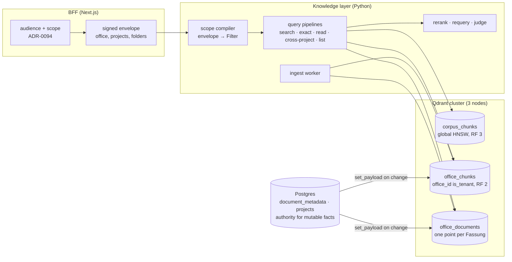

# Retrieval on Qdrant, from first principles

Status: **accepted 2026-10-13; built. Qdrant is the only vector store:
Chroma, its mirror and the `AIQ_VECTOR_BACKEND` flag are gone (slice 3, §12).**
The two decisions it rests on are
[ADR-0113](../adr/0113-qdrant-replaces-chroma-reached-through-qdrant-client.md)
(the store and the client) and
[ADR-0114](../adr/0114-retrieval-scope-is-a-payload-filter-compiled-in-one-place.md)
(scope as a filter, not a collection). What is built, and where it departs
from the target below, is §12. The gates in §10 decided the move
([results](qdrant-gates-2026-10.md)); §2 describes the Chroma-era system the
design started from.

This is not a port. A port would copy today's collection-per-scope layout into
Qdrant and keep every workaround that layout made necessary. Instead, this doc
asks what retrieval has to do for an office, sorts each existing mechanism into
domain need or Chroma workaround, and designs the Qdrant version the way
Qdrant's own guidance recommends.

## 1. What retrieval has to do

Piloti answers from three bodies of text: the legal corpus (`baurecht`), the
office's own filing (`buero`, the Büroablage) and its projects (`projekt`).
Retrieval serves these questions, ordered from most to least frequent:

| Question an architect asks | Retrieval shape |
|---|---|
| "Was sagt die OIB-RL 2 zu Fluchtwegen?" | Hybrid semantic + lexical over the corpus, reranked, a few hits per Richtlinie |
| "Was steht in unserem Brandschutzkonzept zu Stiege 2?" | The same, over one project's documents, never another office's |
| "§ 3 Abs. 2", "OIB-RL 2 Punkt 5.1.1" | Exact-term lookup where the string is the signal |
| "Lies Punkt 5.1.1 ganz" | Fetch by structure (Richtlinie, Punkt, page): no ranking, no embedding |
| "Wie haben wir das beim letzten GK4-Holzbau gelöst?" | Office-wide, ranked across projects, filtered by project facts, one result per project |
| "Welche unserer Projekte hatten eine Auflage zur Fluchttreppe?" | The same, plus counts per project |
| "Welche Dokumente gibt es zu …" / list a folder | Listing and facets, no vector at all |

Everything must hold three invariants that Chroma never enforced. The code
enforced them, through collection names:

1. **Office isolation.** A search never returns another office's chunk.
2. **Restricted folders.** A chunk in a restricted folder reaches only people
   cleared for it (ADR-0087). Who counts as cleared is decided by the
   conversation's audience (ADR-0094).
3. **Fassung truth.** A document that a person marked as superseded drops out
   of answers unless someone asks for it (ADR-0099).

## 2. What we had, sorted

These are the full findings of the 2026-10-13 audit of the Chroma-era layer,
condensed; the line numbers are that code's. Paths are
relative to `sources/knowledge_layer/src/` unless they are absolute.

**Domain needs we keep**, whatever store sits underneath:
- the signed scope envelope (ADR-0047/0084)
- the audience rules (ADR-0094)
- the durable fair ingest queue (ADR-0076/0079)
- OIB hash gating plus `CHUNK_FORMAT_VERSION`
- the query-embedding cache and warm-up, since embedding costs 280–980 ms and
  the store only 50–230 ms (`turn-latency-measured-2026-09.md`)
- the cross-encoder rerank, the requery loop, the coverage judge, and the
  EN→DE glossary expansion
- `keyed_lock` plus retire-after-insert for concurrent re-ingest
- the orphan sweep (multi-store deletes are not atomic)

**Workarounds for Chroma or LlamaIndex-over-Chroma**, which go away:

| Mechanism | Where | Why it exists |
|---|---|---|
| `$contains` exact-term channel, priced by a `collection.get` per term | `llamaindex/hybrid.py`, `adapter.py:6291` | Chroma has no lexical index |
| Postgres `chunk_text` mirror for German FTS, with hits fetched back from Chroma by id | `src/aiq_agent/knowledge/chunk_text_store.py` | Same |
| Cosine recovered from `exp(-d)` | `adapter.py:998, 6393` | LlamaIndex's Chroma score scale |
| RRF *across collections*, rank padding | `register.py:616-850` | N collections give N incomparable score bands |
| 3× over-fetch, then post-filter on `doc_class`, title, folder | `register.py:48, 1132-1173, 2049` | Human-set metadata lives only in Postgres and cannot reach the store |
| `file_name $in/$nin` lists for folders and superseded Fassungen | `register.py:2100, 2115` | Chunks carry no folder or document id |
| `read_passage` embeds a dummy label query to fetch by filter | `read_passage.py:1036` | No fetch-by-filter path was used |
| File listing by scanning all metadatas, page size 5000 | `adapter.py` `_get_all_metadatas` | Chroma doubled as the file registry |
| `_bound_chroma_http` private reach-in | `adapter.py:296` | The chromadb client sets no timeout (2026-10-12 outage) |
| Single-replica StatefulSet | `deploy/pulumi/src/data/chroma.ts` | Open-source Chroma is single node |

**Accidents inherited from the NVIDIA template**, which go away:
- random LlamaIndex node ids, read back after insert
- metadata rendered into the embedded text, with an exclusion list to undo it
  (`adapter.py:778`)
- the 24 h prefix-based TTL reaper on `s_` collections
- no office, document or folder id on any chunk: identity is
  `(collection, file_name)` (`src/aiq_agent/knowledge/schema.py:166`,
  ADR-0087 l. 40)

**One consequence that is a design choice rather than an accident:** moving a
document across a restriction boundary purges and re-embeds it, because the
restriction *is* the collection (ADR-0087). Qdrant makes it a payload update
(§5).

## 3. Target shape



There are three collections, one per data shape. Clients reach each one only
through an alias (`corpus`, `office`, `documents`), so a rebuild is an atomic
alias switch.

| Collection | Holds | Why separate |
|---|---|---|
| `corpus_chunks_v1` | The legal corpus per country profile (`oib_knowledge` today) | No tenant. Every office reads it, so it gets a global HNSW, 1 shard and RF 3, and every node serves it locally |
| `office_chunks_v1` | Every chunk an office owns: Büroablage, projects, restricted folders, conversation uploads | One tenant-partitioned index, which is Qdrant's recommended multitenant layout. `office_id` is indexed `is_tenant`, so each office's data sits together on disk |
| `office_documents_v1` | One point per document Fassung: a summary vector plus document metadata | Document-level search, `with_lookup` joins for grouped results, "similar documents", facets |

What does *not* move: project memory, platform lessons and permit records keep
their `real[]` vectors in `grid_app`. They are small, transactional and
RLS-bound ([`semantic-notes.md`](semantic-notes.md)). The trigger to revisit is
any of them passing about 50k rows per office, or needing to be fused with
document hits in one ranking.

## 4. Points, vectors, payload

### Point identity

`point_id = UUIDv5(NAMESPACE, f"{document_version_id}:{chunk_ordinal}")`. It
is deterministic: re-ingesting a Fassung overwrites its own points and cannot
duplicate them, so no id needs reading back after insert. Retiring a Fassung is
one delete by `document_version_id`.

### Named vectors

| Name | Kind | Source | Storage |
|---|---|---|---|
| `dense` | 3072-d cosine | `openai/text-embedding-3-large`, unchanged from today | Quantized copy (TurboQuant 4-bit, or int8 if the spike says so) in RAM, originals on disk; rescoring off, measured (§12) |
| `lexical` | sparse, `modifier: idf` | Server-side `qdrant/bm25`, `language: german`, built from `text` at upsert | Sparse index pinned in RAM |

The embedded text is built explicitly: chunk body plus a short header
(Richtlinie/Punkt title or document title). LlamaIndex no longer renders the
metadata dict into it, and the exclusion list goes away.

**Dimension.** OpenAI documents that the v3 embeddings can be shortened by
truncation plus L2 renormalisation, which is equivalent to the API's
`dimensions` parameter. A 1024-d vector can therefore be *derived from the
stored 3072-d one* with no API call. The spike measures recall at both
dimensions (gate G6). If 1024 holds, it becomes a second named vector filled
from the stored vectors, and `dense` is dropped afterwards (add and delete named
vectors, Qdrant 1.18).

### Payload

The payload is flat and typed. Chunk text is a top-level field. There is no
`_node_content` blob, which would duplicate the text and hide it from the
full-text index.

| Field | Type, index | Meaning |
|---|---|---|
| `office_id` | uuid, `is_tenant` | Owning office (`office_chunks`, `office_documents`) |
| `shelf` | keyword | `buero` / `projekt` / `session`; `baurecht` lives in `corpus` |
| `project_id` | uuid | Project, when shelf is `projekt` |
| `conversation_id` | uuid | Conversation, when shelf is `session` |
| `folder_id`, `folder_ancestors[]` | uuid | Folder and every ancestor, so "this folder and below" is one match |
| `restriction_id` | uuid, or absent | The restricted folder that governs access (ADR-0087). Absent means open |
| `document_id`, `document_version_id` | uuid | The document and its Fassung |
| `superseded` | bool | Mirror of `document_metadata.superseded_by` (ADR-0099) |
| `doc_class` | keyword | Dokumentart, as a person set it or ingestion suggested it |
| `tags[]`, `topics[]`, `disciplines[]` | keyword | Mirror of person-set tags (12 document types, 6 OIB disciplines) |
| `project_status` | keyword | `active` / `paused` / `closed` (ADR-0098) |
| `project_facts.*` | keyword / integer | Fingerprint: `bundesland`, `gebaeudeklasse`, `bauweise`, `nutzungen[]`, `vorhabensart` |
| `content_type`, `chunking` | keyword | text / table / image / drawing; punkt / section / page |
| `evidence` | bool | Replaces `chunking != page` and the YAML change-log list |
| `page`, `page_end`, `section_order` | integer | Locators; `section_order` is `is_principal` for ordered reads |
| `reading_order` | integer | The page a chunk starts on, 0 when it has none; derived at write time, what a structural fetch orders by (§6) |
| `chunk_ordinal` | integer | The chunk's place in its file, 0 for the first the chunker cut; written at ingest and by the import (in the export's order). Point ids are random node ids, so it is what orders the chunks of one page (§6) |
| `richtlinie`, `punkt_id`, `punkt_path`, `punkt_depth` | keyword / integer | Corpus structure (corpus only) |
| `country`, `edition` | keyword | Corpus profile and OIB edition |
| `file_name`, `title` | keyword, `text` | Display, plus the title-contains filter |
| `text` | `text` index (`word` tokenizer, lowercased, `ascii_folding`, `phrase_matching`; no stemmer, so a phrase is the literal words) | Chunk body. Feeds phrase and exact queries. `word` keeps digits: `multilingual` drops them, and "5.1.1" or "43" matched nothing (§12) |
| `paragraph_refs[]` | keyword | Every `§ n` the text cites (`§ 3`, `§ 12.1`, `§ 3a`), derived at write time. No tokenizer keeps the `§`, so "§ 3" as a phrase is the token `3` and matches "Abs. 3" |
| `stand` | datetime, `is_principal` on documents | Document date, for recency |

Payload indexes are created *before* the first upsert (Qdrant builds the
filterable HNSW links at index time). **Strict mode** is on with
`unindexed_filtering_retrieve: false`, so a filter on an unindexed field fails
loudly instead of scanning.

### Mutable facts: Postgres stays the authority

`doc_class`, tags, topics, `superseded`, folder placement, restriction, and
project status and facts are all edited by people in Postgres. They are
**mirrored** onto points by filter, never re-embedded:
`set_payload(filter: document_id = X, payload: {...})`, or
`filter: project_id = P` for project facts.

- The write happens in the same request that changes the Postgres row, after
  the commit.
- The mirror carries a `meta_version`, and conditional updates (1.16) refuse to
  apply an older version over a newer one.
- The existing weekly reconcile (`frontends/ui/src/lib/platform/vector-reconcile.ts`)
  repairs drift by copying again rather than by sampling and comparing: its
  document facts half sends every live collection, in batches of 25, to
  `POST /v1/maintenance/refresh-document-facts`, which runs
  `writes.copy_facts(scope)` per collection (the same copy an edit makes,
  raising instead of swallowing a failure) and reports the files copied and
  the collections that failed.

This removes the 3× over-fetch and the `$in`/`$nin` file lists. Each filter
becomes a pre-filter inside the vector search. The post-filters in
`register.py` stay as a backstop over hits that already match, because a
mirror can lag: a pre-filter may only narrow what the Postgres post-filter
allows, never widen it. A stale fact can therefore cost recall but cannot
show something wrong. The superseded exclusion is the one case where a stale
fact *would* show something wrong (a replaced Fassung back in the ranking), so
the Postgres list still drops those hits after retrieval.

## 5. Access: one scope compiler

Collection names stop being the security boundary, so something else has to be
one. That job goes to a single function:

```python
def compile_scope(envelope: SignedScope, *, purpose: Purpose) -> models.Filter
```

- **The input is the verified envelope only:** office id, reachable project
  ids, cleared restriction ids, conversation id, and shelves. This is the same
  envelope as today, carrying ids instead of collection names.
- **Every filter it returns carries `office_id`.** No code path can omit it.
- **Restricted folders become a filter:**
  `should: [restriction_id is_empty, restriction_id in cleared]`. A tool cannot
  forget the rule because it never writes the filter itself, which is what
  ADR-0087 wanted from separate collections.
- **Superseded Fassungen are excluded unless `purpose` asks for history.**

The ratchet, in descending order of strength:

1. Only `knowledge_layer/qdrant/` imports `qdrant_client`. An import-linter
   contract fails the build for any other importer.
2. The read API pods hold the **read-only API key**. Only ingest workers hold
   the write key.
3. A property test generates random envelopes over a seeded multi-office
   collection and asserts that no result ever has a foreign `office_id` or an
   uncleared `restriction_id` (gate G3).
4. Strict mode rejects unindexed filters.

JWT payload claims can no longer enforce this: Qdrant deprecated the payload
constraint in 1.15. Enforcement therefore stays in our code, which matches
ADR-0055 (one API and one typed client).

**Moving a document across a restriction boundary** becomes one `set_payload`
on `restriction_id`. The purge-and-re-embed placement job (ADR-0087) and its
lag window go away.

## 6. Query pipelines

Every pipeline is a single Query API call, and every one starts from
`compile_scope`. These are sketches; the spike tunes `limit`, weights and `k`.

**`knowledge_search` (hybrid).**

```text
prefetch:
  - query: <dense query vector>, using: dense, limit: 60, filter: scope
  - query: Document(text, model: qdrant/bm25, options: {language: german}),
    using: lexical, limit: 60, filter: scope
    params: { idf: { corpus: { office_id: O } } }   # per-office IDF, 1.19
query: { rrf: { k: 60 } }                            # no weights: measured, §12
then (nested): formula boost
  $score + 0.05 * (doc_class in boosted) + gauss_decay(stand) for recency questions
group_by: document_id, group_size: 3, limit: 16       # replaces the soft per-file cap
```

- The corpus and office collections are queried in one `query_batch`. Their
  hits are fused in the application by RRF, because they are two indexes. The
  cross-encoder then reranks the fused pool, as today.
- Qdrant documents RRF's `k` default as 2, not the canonical 60, so it is
  always set explicitly.
- As built, every knob of this call is one value, `search.RANKING`. The
  sweep measured `k` 20/60/100, dense weights 1.5 to 3, DBSF, MMR and
  rescoring, and kept plain RRF at 60; RRF ties are ordered by cosine in the
  application, because Qdrant returns them in no fixed order
  ([gate report](qdrant-gates-2026-10.md#ranking-sweep-2026-10-13)).
- Fusion inside a prefetch is computed per shard, so fusion stays at the top
  level. That rules out the "then (nested)" formula above on a sharded
  collection: a boost rescores each channel before the fusion instead, and
  grouping is done over the flat fused list (§7 "As built").

**Exact mode.** It runs as `filter: text phrase "…"` (or `text_any`) with no
vector, ordered by `section_order`. Qdrant has no regex. `match="exact"`
today uses `$regex` (`adapter.py:6006`), and the spike checks whether phrase
matching with `ascii_folding` covers its real queries (gate G1b). If it does
not, exact mode keeps reading the Postgres mirror, and the mirror stays for
that one job.

**`read_passage` and the family overview.** `scroll(filter: file_name = F and
the Punkt, page or outline clause, order_by: reading_order)`. No embedding and
no ranking. Built: `BaseRetriever.fetch`, `qdrant/reads.py`.

The order exists for the cut only. The reader sorts what it gets by page, then
Punkt number, then section, line and part, so no single integer can carry its
order, and none needs to: `reading_order` is the leading term of that sort
(the start page, as `Chunk.page_number or 0` reads it), and a cut in it that
never splits a tie keeps exactly the chunks the reader's own sort would have
kept from the whole set. The fetch reads the first N by `reading_order` and
then the rest of the last one's tie group. A point written before the field
existed has no value and `order_by` would skip it, so a set holding one (or a
collection without the index) is ordered client-side from `page_label`, which
the field is derived from. `ensure_collection` adds the missing index on the
next write; the import from Chroma rewrites the payloads of the points it carries.

A reader of a whole document (the Fassung compare, `collection_pages.read_pages`)
needs the order within a page too, and no server-side order gives it: a
`SentenceSplitter` chunk of a PDF page carries no position, and point ids are
the chunker's random node ids. `reads.in_document_order` sorts by page, then by
the section structure `read_passage` sorts by (`base.section_position`:
section, first line, part), then by `chunk_ordinal`, then chunk id. A point
written before `chunk_ordinal` existed sorts after the numbered ones of its
place, by chunk id: stable, though not the chunker's order, until it is
re-ingested or the import runs over its collection again.

**Listing and facets.** `facet(key: doc_class | project_id | tags, filter:
scope)` returns the counts. The file list itself stays a Postgres read, because
Postgres is the registry.

**Similar documents.** `query(recommend: positive [document point], using:
summary, lookup_from: documents)` over `office_documents`.

**Similar passages** (built, §12). `query: <point id>, using: dense,
lookup_from: corpus` when the source sits there, `filter: scope + superseded
!= true + must_not (the source file, its grid_document_id)`, rescored, then
grouped by document (scope and file name) in ranking order. The source's own
vector is the query whenever the passage is a stored chunk; only a selection
is embedded. Dense only: a whole passage as a BM25 query has no measured
benefit yet.

## 7. Cross-project search

### Before Qdrant

How ADR-0094 search ran before this design was built (`frontends/ui/src/lib/cross-project/service.ts`);
"As built" below says what runs now: a page of up to 40 projects
(`CROSS_PROJECT_PAGE_PROJECTS`) in one grouped query, at most 500 collections
(`BACKEND_SEARCH_MAX_COLLECTIONS`, the backend's cap).
- It took up to 8 projects in hand-weighted fingerprint-similarity order and
  searched them in waves of 4.
- Each project cost one HTTP search per collection, plus one file-listing call
  for tags.
- The merged hits were sorted by **raw score**, although the knowledge layer's
  own merge states that scores are not comparable across collections
  (`register.py:703-722`).

The consequences:

| Limitation | Caused by |
|---|---|
| "Which projects had X" meant paging `offset` 8 projects at a time; there was no office-wide top-k | Collection per project |
| Cost grows linearly in projects; "sign every project into scope" was rejected for that reason (ADR-0094 l. 288) | Collection per project |
| Raw-score merge across collections | Collection per project |
| Tag and project-fact filters run after retrieval, with 3× over-fetch | Tags and facts are not on chunks |
| Cleared restricted folders in shared chats are queried, then discarded | Restriction is a collection |
| Folder ACL change means re-ingest with a lag | Restriction is a collection |
| No counts ("6 von 8 Projekten in NÖ") | No shared index to facet |
| Projects past the 500 newest are invisible | `PROJECT_LIST_LIMIT` in the BFF, not the store |
| `gebaeudeklasse` is mostly empty, so similarity is starved | Data quality, not the store |

### On Qdrant

One query over `office_chunks`:

```text
filter: compile_scope(envelope, purpose=cross_project)
        # office_id = O, project_id in reach (or project_status = closed for wide chats),
        # restriction_id empty or cleared, superseded = false
        + optional: project_facts.bauweise = holz, doc_class = detail
prefetch: dense + lexical (as §6), rrf
formula:  $score + 0.10 * (project_facts.gebaeudeklasse = current.gk)
                 + 0.05 * (project_facts.bundesland = current.bl)
group_by: project_id, group_size: 3, limit: 20
with_lookup: documents                       # title, Fassung, date per hit
```

This is the first sketch. Neither the formula over the fusion nor Qdrant's
`group_by` with a fusion holds on 1.19; "As built" below says what runs instead.

What this enables:

1. **Office-wide ranking in one call.** "Wie haben wir das gelöst?" ranks every
   reachable project by relevance. The waves go away, and the page grows
   from 8 projects to 40, bounded by the backend's 500 collections per search;
   `offset` paging stays for an office with more. The cost argument against
   wide reach goes away.
2. **Comparable scores.** There is one index and one query, so the raw-score
   merge problem disappears rather than being worked around. The cross-encoder
   reranks the grouped top hits across projects, which today's path never does.
3. **Similarity as a relevance boost, not a walk order.** The fingerprint
   weights become formula terms on relevance. Before, they decided which 8
   projects got searched at all. The weights are still hand-set, but a wrong weight now
   nudges a ranking instead of hiding a project.
4. **Real filters.** "Alle Dachdetails von Holzbauten in NÖ" is a pre-filter
   (`doc_class`, `project_facts.bauweise`, `project_facts.bundesland`) inside
   the vector search. The retriage document asks for exactly this
   (`docs/audit/upload-and-filing-retriage-2026-10-06.md` l. 228).
5. **Counts.** `facet(project_id)` and `facet(project_facts.bundesland)` on the
   same filter give "6 von 8 Projekten in Mödling" without fetching passages.
6. **A cheap catalog.** The `<referenzprojekte>` list (ADR-0094 l. 134) can be
   ranked by a `recommend` over project-level vectors (the mean of a project's
   document summaries in `office_documents`). Today it uses the fingerprint
   alone.
7. **Restrictions without waste.** Uncleared restricted chunks are filtered
   out before scoring instead of fetched and discarded. A folder moved into or
   out of restriction is effective at the next query.

### As built: facts on points, pre-filters, likeness

Items 3 and 4 are built (2026-10-13). Three things the sketch above assumes
did not hold on Qdrant 1.19.2, and the build differs from it there.

**Facts on points.** Every chunk of a project's collections carries
`project_facts.{bundesland, gebaeudeklasse, bauweise, nutzungen, vorhabensart}`
and `project_status`, indexed (`qdrant/schema.py`; a collection created
before them gains the indexes in place, `ensure_indexes`). What is copied is
what the BFF's similarity reads (`similarityFacts`: confirmed facts, else the
agent's suggestion). One endpoint writes it, `PUT
/v1/collections/{c}/project-facts`, which runs a `set_payload` by scope. The
BFF calls it after every profile save or patch (`persistProfile`) and every
lifecycle move (`setProjectStatus`), once per collection of the project. The
call is awaited and never thrown: the person's change is committed, and the
copy never decides access. A new document's ingest job carries the facts
itself, and the weekly vector reconcile pushes every project as backfill and
repair (`cross-project/project-facts-mirror.ts`).

**Pre-filters.** The type and discipline filters of a cross-project search
run inside the query, on the chunks' `tags`. Grouped mode asks each project for
`limit` documents instead of three times that. The BFF's `matchesTags` stays as
a backstop that judges by the document row. The endpoint also takes
`project_facts` and `project_status` filters.

**Fact filters in the agent's contract.** `project_lookup` takes
`project_facts` (one flat token list for the model; `projectFacts` on the
wire, `crossProjectFactsSchema` in `types.ts`) for `search` and `find`. The
BFF judges them on the Postgres profile (`holdsFacts`, which reads what
`similarityFacts` reads and so what the mirror copies), over the audience's
reach and before the page is cut. It does not pass them to the grouped query
as `filters.project_facts`, for two reasons:

- the page then holds only matching projects, so the collections named
  already carry the filter, and `projectsInScope`, the paging, the decisions
  and the permits (Postgres reads over the page) describe the same set. A
  filter applied only inside Qdrant would page over 40 projects of which a few
  match, and hand out decisions and permits of projects the asker excluded;
- the copy on the chunks can lag. A backfilled chunk carries no facts until the
  weekly sync, and the endpoint's filter does not match a project whose facts
  were never mirrored, so a second filter there would drop projects Postgres
  says match.

`similar` and `closed` keep their likeness order and send the current
project's boost: facts narrow, likeness ranks what is left. The endpoint's
`project_facts` filter becomes the narrowing once the envelope stops listing
project ids (slice 2 below), and the lag matters then.

**Likeness: per channel, before the fusion.** The sketch puts `$score + w ×
fact` over the fusion. Qdrant computes a fusion that sits inside a prefetch on
each shard, over that shard's points ("a fusion merges results across all
shards only when it is the main query"), and a main query cannot be both a
fusion and a formula. The fusion has to stay the main query, so a formula
cannot rescore it. With `$score` alone as the formula, nesting matched the
top-level fusion's grouped top 10 at 0.84 on one shard and 0.39 on six;
`office_chunks` is planned at six (§9). Separate likeness channels fused beside
dense and BM25 fail too, because weighted RRF scales a channel's rank, not its
vote: weight `w` adds `1 / (k − 1 + rank / w)`, measured. So each channel is
rescored by a pointwise formula before the fusion:

```text
$score × (1 + 0.05 × Σ weightᵢ · conditionᵢ / most)
```

`conditionᵢ` are the terms of `similarity()` (the Land, the same or a
neighbouring Gebäudeklasse, Bauweise, one and two shared uses, Vorhabensart).
The weights come in the request from `SIMILARITY_WEIGHTS`, so they live in one
place. A project sharing every fact gains 5 % of its own score in each channel.
The ranking is identical on one and six shards (`test_qdrant_boost.py`).
`similar` and `closed` scopes send the current project's boost; `all` and
`named` send none.

**Grouping is done in our code.** Qdrant's group query with a fusion as its
query fuses again for every round of groups it collects. Each round's best
passage scores rank 0, so the groups interleave by round instead of by
relevance. That was true of the slice-1 call and is pinned by a test.
`grouped_search` now asks for one flat fused ranking and groups it in order.
The route then orders DOCUMENTS across projects by their best fused score. It
used to list every document of the best project before the next project's, so
one project's weak documents filled the BFF's first page.

**No fallback.** Qdrant is the only store (ADR-0113), so the grouped query
is the cross-project search's one path. The per-project loop that searched 8
projects 4 at a time on Chroma, the `GET /v1/collections/search/capability`
probe the BFF asked before authorizing a page, and the route's 409 that sent
it to that loop are gone. A failed grouped search is a 500 from the route and
an `UpstreamError` (502) from the BFF, which the agent's tool words as „gerade
nicht erreichbar", never an empty page it would read as „nichts gefunden".

**Counts (item 5) are not built.** A facet counts chunks matching a filter, not
passages relevant to the question: without a phrase or a relevance threshold,
"6 von 8" would count projects that hold documents of the type, not projects
that answered. The answer already says which projects its hits come from and
how many were searched (`projectsSearched`). Counts wait for a lexical phrase
condition the agent can ask for.

What stays as it is:
- the audience rules
- recording at hand-out and the 409 on an audience change
- the Jev hit judge

These are policy. They decide what goes into the envelope, and Qdrant only
executes it. Two things need product decisions this design does not take:

- Whether `read_passage` may open another project's document (today it cannot,
  `tools/cross_project/register.py:27-31`). Points carry `document_id` and the
  compiler can authorize per hit, so it becomes technically possible.
- Lifting the 500-project listing cap. For wide chats the envelope can say
  `project_status = closed` instead of listing ids, so the cap stops mattering
  there.

## 8. Client layer

`qdrant-client` (async, gRPC) is used directly inside `knowledge_layer/qdrant/`.
LlamaIndex stays for loaders, parsing and chunking only:

- `llama-index-vector-stores-qdrant` 0.10.4 issues dense and sparse as two
  requests and fuses them client-side (`relative_score_fusion`).
- It uses no `prefetch`, server-side fusion, formula, `group_by`, MMR or server
  BM25.
- It stores the node as a `_node_content` JSON string, so the text cannot carry
  a full-text index.
- Our adapter already bypasses its Chroma sibling about 40 times.

The `BaseRetriever` / `BaseIngestor` seam (ADR-0072) stays. The backend behind
it changes, which is the path ADR-0072 itself named for this case.

## 9. Deployment

| Setting | Value | Reason |
|---|---|---|
| Version | 1.19.x, upgraded minor by minor | Self-hosted cannot skip minors. Snapshots restore only into the same or next minor |
| Nodes | 3, one per data node, anti-affinity | 2 nodes cannot keep Raft quorum through one failure |
| Pulumi | Own StatefulSet in `deploy/pulumi/src/data/qdrant.ts`, modelled on `chroma.ts` | Data stores here are raw StatefulSets. `qdrant-helm` 1.19.2 serves as the oracle, diffed on each minor upgrade |
| Pod management | `Parallel` | OrderedReady can deadlock cluster bootstrap |
| Probes | readiness `/readyz`, liveness `/livez`, never liveness on `/readyz` | `/readyz` fails during Raft catch-up, and as liveness it cascades restarts |
| Grace period | 120 s; memory request = limit | WAL flush; OOM during optimization is the top reported failure |
| `office_chunks` | 6 shards, RF 2, `write_consistency_factor` 1 | OSS cannot reshard, so 6 fits 1/2/3/6 nodes. Consistency 1 keeps writes going while one peer is down (a rollout, a drain); at 2, writes to about 4 of the 6 shards failed then. The lagging replica catches up from the WAL when its peer returns, so a write is durable on both only after that; Chroma and the backfill are the net behind the window while Chroma is still written. Transient write failures are retried in the store (3 retries, 0.2/0.8/2 s), never a 4xx. Drilled on three 1.19.2 peers: at 1 the returning peer recovered 600 of 600 points; at 2 it stayed silently behind at 546 (§12) |
| `corpus_chunks` | 1 shard, RF 3 | Small and read by every query |
| Size, start | 4 vCPU / 16 GB per node, data PVC on the Lightbits class at 2× data | Today's whole store fits in a 20Gi PVC and 3–6 Gi RAM |
| Security | API key plus read-only key from Secrets, `enforce_internal_auth`, p2p TLS via cert-manager, NetworkPolicy on 6333/6334/6335 | Open-source Qdrant is open by default |
| Backups | CronJob: a snapshot of every shard of every collection to a SeaweedFS bucket (`snapshots_config` s3, `endpoint_url`); `GET /aliases` recorded beside them (`aliases/`) by the same job | No cluster-wide snapshot exists, and aliases are not in snapshots. Restore, per peer and per shard, is drilled in the runbook |
| Metrics | OTel collector Prometheus receiver, scraping each peer's keyless metrics port (`service.metrics_port`, 6336) by its headless name, re-exposed on the collector's `:8889`; alert rules in the `qdrant-alert-rules` ConfigMap | No Prometheus or metrics backend runs today, so the series are consumable but nothing stores them or evaluates the rules yet. `/metrics` reports only the peer it is called on. On 6333 it needs the key; the metrics port needs none, so the collector holds no Qdrant credential |
| Quotas | `storage.quotas`: writes refused (507) above 90% of the memory limit or 85% of the volume | An OOM kill mid-optimisation or a full WAL becomes a refused write the ingest queue retries, and `quota_exceeded` says which |
| Operations | [`qdrant-runbook.md`](../deployment/qdrant-runbook.md): restore, peer replacement, resync, growth, rebuild, OOM, quotas, upgrade, key rotation, the flag flip | Gate G4. Drilled on 2026-10-13 against real containers, with timings |
| Growth | Add a node, then `replicate_shard` / `move_shard`. A shape change means a new collection, a scroll-and-upsert copy of stored vectors, and an alias switch | No resharding or auto-rebalancing in OSS |
| Large office | Tiered multitenancy (1.16) promotes one office to its own shard. It requires custom sharding chosen at collection creation | Decided in the spike from the largest office's point count (Q4) |

New environment variables (`AIQ_QDRANT_URL`, `AIQ_QDRANT_API_KEY`,
`AIQ_QDRANT_READ_ONLY_KEY`) get their rows in
[`environment-variables.md`](../deployment/environment-variables.md) in the
change that adds them.

**Observability (ADR-0089).** Every pipeline call is a Langfuse span
`retrieve.<pipeline>` carrying, as metadata:
- the collection alias
- the prefetch limits
- the fusion and its weights
- the filter *fields* used (never values)
- the server-reported `time`, and hit and group counts

Isolation-test failures and strict-mode rejections are scores.

## 10. Spike: gates before anything is built

The spike runs on a copy of production data, which takes no re-embedding (§11).
Each gate is a number with the place it is measured.

| Gate | Pass when | Measured by |
|---|---|---|
| G1 answer quality | No regression on the answer suite; per-expectation diff reviewed | `task be:eval:answer-suite`, Chroma vs Qdrant |
| G1b lexical | Qdrant German BM25 recall ≥ Postgres `german` FTS on the lexical query set, including `§`, `5.1.1`, ALLCAPS codes and compounds; exact mode returns what a full regex scan returns (what Chroma `$regex` returned) | `task be:eval:qdrant-parity`, lexical and exact-mode sections; the Postgres numbers are fixed since Chroma's removal (`baseline.py`) |
| G2 latency | p95 store time per `knowledge_search` ≤ today's 230 ms with one Query API call | Langfuse `retrieve.knowledge_search` |
| G3 isolation | 50k random envelopes, zero foreign `office_id` or uncleared `restriction_id`; strict mode rejects an unindexed filter | New property test in the knowledge-layer suite |
| G4 operations | SeaweedFS snapshot upload and restore works; killing a pod mid-ingest at RF 2 loses no acknowledged write; node-replacement drill timed and written as a runbook | Spike runbook |
| G5 memory | A full backfill and optimization run stays under the memory limit without OOM | Pod metrics during backfill |
| G6 dimension | Recall at 1024-d derived from the stored 3072-d vectors is within 1 point of 3072-d | `task be:eval:qdrant-parity` dimension section, on the production embedder |

**Measured 2026-10-13 on the OIB corpus:**
[`qdrant-gates-2026-10.md`](qdrant-gates-2026-10.md).

- G1b passes, with exact mode identical to `$regex`. G2 passes locally (p95
  34 ms).
- G6 fails its 1-point bound: recall@1 drops by one to two of 46 questions,
  so `dense` stays 3072-d.
- Ranked `§` lookups regressed against Chroma's `$contains`; the `paragraph_refs` keyword channel closed it („§ 8“ P@10 0.50 on both paths, [re-run](qdrant-gates-2026-10.md#re-run-on-the-merged-code)).
- Two defects in the Qdrant path, found and fixed there: the text index
  dropped digits, and BM25 was sent unpriced.
- G1 passes. The answer suite through the real agent (29 questions, two
  runs each, two passes per path) held the same 180 of 192 checks on Qdrant
  as on the pre-migration Chroma baseline, with no content expectation lost,
  and the same seconds and reasoning tokens per question (median deltas
  −0.3 s and −22 tokens). Retrieval differs by about 15 points of result
  overlap beyond run-to-run noise without reaching a checked answer
  ([G1](qdrant-gates-2026-10.md#g1-answer-quality-pass)).
- G3, G4 and G5 are not measured by these runs.
- The ranking sweep (`--variants all`) measured rescoring, RRF `k`, dense
  weights, DBSF, MMR and BM25 compound splitting against the same corpus and
  adopted one setting, a cosine tie-break for RRF ties. The exact-id and
  overview gaps were BM25 fed umlaut stopwords and file-name pieces, now
  fixed (exact-id recall@16 1.000, overview 0.967, both above Chroma)
  ([sweep](qdrant-gates-2026-10.md#ranking-sweep-2026-10-13)).

Open questions the spike answers:

- **Q1.** Does `is_tenant` with `m: 0, payload_m: 16` keep project-filtered
  latency within G2, or does it need ACORN?
- **Q2.** Are chunk ids persisted anywhere outside the store (citations,
  `already_read`, Langfuse scores)? If yes, keep `legacy_chunk_id` on points for
  one release.
- **Q3.** Can Qdrant BM25 retire the Postgres `chunk_text` mirror entirely, or
  does exact mode keep it? *Measured:* the mirror is not needed for either job.
  BM25 matches or beats it on the lexical set. Exact mode stays a regex over a
  Qdrant scroll (`find_text`): the phrase index alone misses in-word matches
  (`Geschoss` 88 of 255) and cannot see `§`
  ([gate report](qdrant-gates-2026-10.md#g1b-lexical-pass)).
- **Q4.** How many points does the largest office hold, and is that enough to
  justify custom sharding now?

## 11. Migration: copy, don't re-index

Chroma holds the ids, the 3072-d embeddings, the chunk text and the metadata,
so the move copies them and re-parses, describes and embeds nothing; Qdrant
computes the lexical sparse vector from `text` at upsert. The copy is two
programs that share a file format and nothing else, so no Chroma code stays
in the product (ADR-0113):

- **The exporter**, `deploy/migration/chroma_export.py`, runs beside Chroma in
  a throwaway Python container with `chromadb` pinned to the server's version
  (the `chromadb/chroma` image has no Python). It reads every collection in
  pages, from a copy of the persist directory or from the running server, and
  writes `piloti-vectors/1`: a manifest (count, dimension, the collection's
  metadata with its embedder fingerprint, an order-independent digest of the
  ids) and gzipped JSON-lines batches of id, float32 vector, text and metadata.
- **The importer**, `qdrant/import_vectors.py` and `scripts/import_vectors.py`,
  reads that format into Qdrant through `QdrantStore.upsert(insert_only=True)`,
  so a re-run inserts only what is missing and a point ingestion already wrote
  keeps its ids (§12). It refuses a collection whose fingerprint differs from
  the Qdrant collection's before writing anything, merges the person-set facts
  from `grid_app`, compares the id sets (`--verify`), and deletes what the
  export lacks (`--prune`).

What the export cannot carry stays as it was for the backfill before it: each
point gets the ids its collection name implies (the Büroablage's office), and
the BFF's facts sync fills the project facts. The format and both commands:
[`deploy/migration/README.md`](../../deploy/migration/README.md); the
procedure: [runbook, Migrating from Chroma](../deployment/qdrant-runbook.md#migrating-from-chroma).

The rollout first planned five steps behind a flag (infrastructure, a
dual-writing ingest, a backfill, a read switch, then removal). Slice 1 built
the first four; slice 3 collapsed the rest into one change: Chroma, the flag
and the dual period are gone, and existing data moves once, offline, with the
export/import tool in [the runbook](../deployment/qdrant-runbook.md) (§12
"Slice 3").

## 12. Build status

### Slice 3: Qdrant is the only store (2026-10-13)

The flagged dual period of slice 1 (below) is gone, with no step between: one
change took Chroma out. What was built:

| Part | Where |
|---|---|
| Ingestion writes Qdrant directly: a `SentenceSplitter` per job (the job's chunk size and overlap, no process-wide `Settings`), the ingestor's own embedder over each chunk's EMBED rendering, then `write_chunks`, which enriches every point (office, project, BFF document, folder, project facts, `indexed_at`) and adds the facts the metadata store holds. A failed write fails the file. Point ids stay `point_id(chunk_id)`, the chunker's node ids, so migrated points and fresh ingests agree and citations survive the move | `llamaindex/adapter.py` — `_embedded_records`, `_ingest_job`; `qdrant/writes.py` |
| Re-ingest keeps retire-after-insert: the previous version's chunk ids are read from Qdrant (a `file_name` filter over its spellings, through `store.with_retry`; a read that still fails fails the file before anything is written) before the write and deleted by id after it; a failed or deleted-while-indexing attempt deletes exactly the ids it sent (fresh node ids, so never the previous version's) | `adapter.py` — `_find_previous_versions`, `_retire_previous_version`, `_retire_held_predecessor`, `_discard_partial_version` |
| Every delete is one store's: `delete_file` reads the ids under every accepted spelling and deletes those, `delete_collection` deletes by scope; nothing is deleted or recorded as deleted when Qdrant refuses. Deletes go in bounded requests | `adapter.py`; `store.delete_chunks` (`DELETE_BATCH`) |
| Registry reads from Qdrant: a file listing is one payload-limited scroll (no text); a collection's chunks and files are an exact count and a facet; `list_collections` is one facet per physical collection; a text sample is a structural fetch; visual details and `collection_pages.read_pages` scroll by filter. `get_collection` never answers "missing": a collection is a scope, and an empty one has no chunks (ADR-0114) | `adapter.py` — `_indexed_files`, `_collection_info`, `list_collections`; `collection_pages.py` |
| A collection's `updated_at` (what the reaper of conversation uploads reads) is the newest `indexed_at` on its points, an ordered scroll | `schema.INDEXED_AT_FIELD`, `store.newest` |
| A fact copy follows the rows a register or unregister changes the meaning of: the rows whose `superseded_by` names the file are copied again, so a Fassung that became current is not hidden by `superseded != true` | `factory.register_summary`, `unregister_summary`; `DocumentMetadataStore.files_linked_to` |
| Deleted: Chroma's client and collections, `AIQ_VECTOR_BACKEND`, `qdrant/mirror.py` and `ordered_delete`, the Postgres `chunk_text` mirror, the `$contains` channel and its pricing, `exp(-d)` score recovery, `embed_fingerprint_mismatch` (the identity lives in Qdrant's collection metadata only), the Chroma backfill (`backfill_qdrant.py`, `backfill_chunk_text.py`), and `chromadb` plus `llama-index-vector-stores-chroma` from the dependencies | — |
| One test fixture for every store test: unique aliases per test, the process-wide store pointed at them, both deleted after; skips locally without `AIQ_QDRANT_TEST_URL`, fails on CI | `sources/knowledge_layer/tests/qdrant_testing.py` |
| The import boundary forbids `chromadb` everywhere but the migration tool | `test_qdrant_import_boundary.py` |
| The gate harness runs Qdrant alone: the corpus written through `write_chunks`, read through the production retriever, every number printed beside the Chroma path's from the gate run (fixed, `baseline.py`); exact mode held to a full regex scan, which is what Chroma's `$regex` was | `task be:eval:qdrant-parity`, `qdrant_parity/` |

**Why the file listing reads Qdrant, not `document_metadata`.** Postgres is
the authority for what people set on a document, and the routes merge its
rows into every listing. What a listing states besides (which files are
indexed, how many chunks, which pages and content types) is a fact about the
index, and the two consumers that exist to catch drift between the rows and
the index (`reconcile-summaries`, `reconcile_collection_summaries`) compare
exactly the two: a listing read from the rows would compare Postgres with
itself.

### Built in slice 1

| Part | Where |
|---|---|
| The store: two collections behind aliases, dense + German BM25, TurboQuant, strict mode, payload indexes created before data | `sources/knowledge_layer/src/qdrant/schema.py`, `store.py` |
| Every read filter from one function, refusing an empty scope | `qdrant/scope.py` |
| Hybrid search in one Query API call (dense, BM25 with per-scope IDF, exact-term phrase channels, RRF k=60) and the true cosine per hit | `qdrant/search.py` — `hybrid_search` |
| Retrieval, exact search (`find_text`) and the health check reading Qdrant under `AIQ_VECTOR_BACKEND=qdrant`; the chunk contract unchanged | `llamaindex/adapter.py` — `_qdrant_chunks`, `_find_text_sync`, `health_check` |
| Every Chroma write mirrored (insert, retire, discard, delete file, delete collection), vectors copied, never re-embedded. Removed in slice 3 | `qdrant/mirror.py` (deleted) |
| Person-set facts (tags, topics, Dokumentart, Fassung, folder) mirrored onto points when they change | `aiq_agent/knowledge/factory.py` — `_mirror_facts` |
| The move off Chroma: an exporter in its own environment writing the neutral format `piloti-vectors/1`, and an importer with `--prune`, `--verify`, `--verify-only`, `--dry-run` (it replaced the backfill that read Chroma directly) | `deploy/migration/chroma_export.py`; `qdrant/import_vectors.py`, `scripts/import_vectors.py` |
| Cross-project search: a page of up to 40 projects in ONE grouped query, ordered by the fused ranking; the only path, a failure an upstream error | `POST /v1/collections/search`; BFF `cross-project/service.ts` — `searchPage` |
| Infrastructure: 3-peer StatefulSet, Raft bootstrap, API and read-only keys, snapshots to SeaweedFS with retention, NetworkPolicies, the policy-pack allowance for `Parallel`; Compose service behind `--profile qdrant` | `deploy/pulumi/src/data/qdrant.ts`, `deploy/compose/docker-compose.yaml` |
| Trace metadata: `vector_backend` on every `retrieve.knowledge_search` span (dropped in slice 3, one store) | `register.py` |
| `knowledge_search` pre-filters under `qdrant`: `doc_class = X` (the stored class over the chunk's guess, as `_hit_doc_class` resolves), `superseded != true` on user shelves unless `file_name=` names a file, `folder` as one match on `folder_ancestors` (case-folded paths, `/`-bounded). No 3× over-fetch and no `file_name $in/$nin` lists for them. The Postgres post-filters stay as a backstop, and the Postgres superseded list still drops hits a lagging mirror let through. The span carries `prefiltered: [fields]` | `qdrant/prefilter.py`; `register.py` — `search` |
| Payload indexes added to an existing collection on first read or write (`ensure_payload_indexes`), so a new indexed field needs no rebuild | `qdrant/schema.py`, `store.py` — `exists`, `ensure` |
| Structural reads by filter: `read_passage` (Punkt, page, outline, the whole-document fallback) and the family overview scroll by filter, ordered by `reading_order`, with no embedding and no ranking; Chroma keeps the embedded probe. `family_read` (`fetch` or `retrieve`) on the `retrieve.knowledge_search` span | `BaseRetriever.fetch`, `qdrant/reads.py`, `read_passage._structural_fetch` |
| Document facts (tags, Dokumentart, superseded, folder) copied again weekly, every live collection, so a copy an edit failed to make (`refresh_facts` never raises) is repaired; counted per file, failed per collection | `POST /v1/maintenance/refresh-document-facts` (`routes/maintenance.py`), `qdrant/writes.py` — `copy_facts`; BFF `platform/vector-reconcile.ts` — `refreshDocumentFacts` |
| Project facts and status on every chunk of a project, indexed; pushed on profile save, lifecycle move and ingest, swept weekly | `PUT /v1/collections/{c}/project-facts`, `qdrant/payload.py` — `project_payload`; BFF `cross-project/project-facts-mirror.ts` |
| Cross-project tag pre-filters and the current project's likeness inside the one grouped query (§7 "As built") | `qdrant/boost.py`, `qdrant/search.py` — `grouped_search`; BFF `cross-project/service.ts` — `searchPage` |
| Project-fact filters in the agent's cross-project contract (`project_facts` on `search` and `find`), judged on the Postgres profile before the page is cut; likeness still ranks | `tools/cross_project/register.py` — `project_facts_filter`; BFF `cross-project/types.ts` — `crossProjectFactsSchema`, `service.ts` — `holdsFacts`, `projectsInScope` |
| Similar passages („Im Büro behandelt“): the nearest passages to one the reader is looking at, across the collections the BFF authorized (the reader's project, the projects a solo chat reaches with closed ones, the Büroablage), the source document and superseded Fassungen filtered out in the query. A stored chunk is queried by its point id (by `chunk_id`, or a cited passage found in its file by its text), from the corpus by `lookup_from`; a selection is embedded once through the cached query path. Hits are joined to screened rows only (`SCREENED_ONLY`), so a held document never shows. A `retrieve.similar_passages` retriever observation per call | `qdrant/similar.py` — `find_similar`; `POST /v1/collections/similar` (`routes/similar_passages.py`); BFF `lib/similar-passages/service.ts` — `findSimilarPassages` |
| Grouped answers ordered document by document across projects | `routes/document_search.py` — `_ranked_group_hits` |
| Operations: every peer scraped by the collector on a keyless metrics port, 13 alert rules held to the collector's real export, quotas, the alias record beside the snapshots, alias-based rebuilds, a second key for rotation, the low-memory load mode, and a runbook whose procedures were drilled against real containers | `data/qdrant.ts`, `data/qdrant-alerts.ts`, `platform/otel-collector.ts` — `metricsPipeline`; `qdrant/rebuild.py`, `scripts/qdrant_rebuild.py`; [`qdrant-runbook.md`](../deployment/qdrant-runbook.md) |
| The gate measurement (G1b, G2, G6): both paths over one OIB corpus with one set of production vectors, through the production retriever ([results](qdrant-gates-2026-10.md)) | `task be:eval:qdrant-parity`, `frontends/benchmarks/oib_retrieval/src/oib_retrieval_eval/qdrant_parity/` |
| The ranking sweep: every `search.Ranking` variant read through the production retriever on one collection, per-question moves against a baseline measured first and last; the BM25 compound-splitting experiment ([results](qdrant-gates-2026-10.md#ranking-sweep-2026-10-13)) | `qdrant_parity/variants.py`, `decompound.py`; `task be:eval:qdrant-parity -- --variants all` |
| From the sweep: RRF ties ordered by cosine, then chunk id, with a tie straddling the cut fetched whole (repeated calls returned another top-60 for 86 of 105 queries, now 0), in grouped search before the grouping; the settings named once (`RANKING`) and on the span as `ranking` | `qdrant/search.py` — `Ranking`, `RANKING`, `_cosine_ordered_ties`; `register.py` |
| From the sweep: BM25 never asked for the umlaut stopwords Qdrant's folding lets through (`über`, `für`, …) or for the pieces of a file name | `retrieval.bm25_candidates`, used by `_qdrant_lexical_inputs` |
| From that measurement: BM25 terms priced by the German mirror's own rule (`german_text.select_terms`), with counts cached per collection size. Cross-project grouped search prices them too, and runs the same exact-term channels, with document frequencies over the union of the searched scopes (the corpus its IDF is computed over). It also found the tokenizer defect, fixed below under "Hardened after review" | `adapter.py` — `_qdrant_lexical_inputs`, `_search_grouped_sync`; `retrieval.term_frequencies` |
| Gate G1: the answer suite through the real agent on the pre-migration Chroma baseline and on Qdrant, one ingest read by both ([results](qdrant-gates-2026-10.md#g1-answer-quality-pass)) | `task be:eval:answer-suite -- --ingest --corpus data/oib`, `scripts/turn_census/suite.py` — `use_local_corpus` |

### Hardened after review (2026-10-13)

An adversarial review of slice 1 found these, each fixed with a test that fails
without the fix. No environment had created a Qdrant collection yet, so the
index changes went in place.

| Defect | What changed | Where |
|---|---|---|
| The `text` index used the `multilingual` tokenizer, which drops digits: phrase counts for "5.1.1", "43", "§ 3" were 0, "Abs. 2" ignored its number, and `selective_terms` dropped every numeric exact term the Chroma `$contains` channel served | `word` tokenizer (`schema.TEXT_INDEX`), verified on 1.19.2: "5.1.1", "43", "OIB-Richtlinie 2", "Abs. 2" match exactly, and "Größe", "GRÖSSE", "grosse" stay one token. `§` references go through the `paragraph_refs` keyword field (`search.exact_term`), since every tokenizer drops the `§`. `ensure_payload_indexes` logs an ERROR when an existing text index was built otherwise, naming the rebuild path (new `_vN`, copy, alias switch) | `qdrant/schema.py`, `search.py`, `payload.paragraph_refs` |
| Under `qdrant`, a delete took Chroma first; a Qdrant failure then left deleted, retired or quarantined (ADR-0086) chunks answering every search, and its raise skipped the Chroma-side cleanup | `mirror.ordered_delete`: under `qdrant`, Qdrant first, and a failure deletes nothing anywhere (the caller's retry starts over); under `dual`, Chroma first and the mirror best effort; the metadata row, the lexical mirror and the version bump always run after it. A retried `delete_file` that finds no Chroma chunks deletes Qdrant's by every stored spelling (`tmp…_`, percent-encoded) the adapter's own rule accepts | `adapter.py` (`delete_file`, `_retire_previous_version`, `_retire_held_predecessor`, `_discard_partial_version`, `delete_collection`), `mirror.py` |
| `write_consistency_factor` equalled RF, so one peer down failed writes to most shards | Consistency 1, and transient write failures retried in the store (§9) | `schema.WRITE_CONSISTENCY_FACTOR`, `store.with_retry` |
| The backfill pruned a file ingested between its two reads, stripped `office_id`/`project_id`/`grid_document_id` from points ingestion wrote, never visited a scope Chroma had dropped, and `--verify` compared counts only | Prune reads Qdrant's ids before Chroma's; the copy is insert-only (Qdrant 1.17 `update_mode`) and merges only the chunk's own fields onto existing points, then merges the facts; scopes are enumerated from Qdrant too (facet on `scope`) and `--prune` deletes those Chroma lacks; `--verify` compares the id sets (whole up to 200k chunks, sampled both ways above) | Then `qdrant/backfill.py`; now `qdrant/import_vectors.py` and `scripts/import_vectors.py`, which keep every fix but the read order: an export does not change under the importer |
| A writer dying between `create_collection` and the alias wedged every later writer on the conflict, and the loser of a create race raised | A conflict finishes the collection: indexes added, alias made if missing; two writers finishing it at once agree | `schema._create_or_adopt` |
| `find_text` scrolled the whole scope (20k chunks: about 79 requests, 29 MB) | Narrowed on the server by the words every match of the pattern must hold as whole tokens; the regex still decides. A pattern without such a word (one word over three characters, which matches inside longer words) reads the whole scope as before | `retrieval.literal_tokens`, `find_text` |
| `coerce_field("superseded", "false")` was True; a one-file fact refresh loaded every document of the scope; a folder rename sent one request per file; a cleared Dokumentart stayed on the points | String booleans read for what they say; `get_documents(collection, names)` reads only the named rows; payload updates go in batches of 128, a folder move copies only the folder of the moved files; clearing a stored class puts back the chunk's own (`chunk_doc_class`, written at ingest), which is also what a hit's metadata now carries, as on Chroma | `payload.py`, `mirror.refresh_facts`, `store.set_file_payloads`, `DocumentMetadataStore.get_many` |
| Raw `filters` a model may pass (`punkt_path`, `page_end`, `table_index`, `section_part`, `drawing_type`, …) raised under `qdrant` | Every metadata key the chunkers write and a filter can plausibly name is indexed, with its stored type; large fields (`drawing_data`, `description`) stay unindexed and still raise, naming the field | `schema.KEYWORD_FIELDS`, `INTEGER_FIELDS` |
| `health_check` under `qdrant` ignored Chroma, which is still the write record and serves the registry reads | Healthy only when both answer | `adapter.py` `health_check` |
| Integration review of the merged branches: the project-facts write (`set_scope_payload`) and the rebuild's copy skipped the store's retry, so one 503 from a restarting peer failed a profile save's mirror, or ended a rebuild with a half-copied `_vN` a person had to drop | Both go through `store.with_retry` like every other write | `store.set_scope_payload`, `rebuild.copy_collection` |
| A list-valued equality filter (`{"project_facts.nutzungen": ["wohnen"]}`) was coerced whole into the string `"['wohnen']"` on a keyword field and matched nothing | A list is any of its values, on every field type | `scope._match` |
| Compose's `qdrant` service had neither the metrics port nor the write quotas of the Pulumi peers | Both set, the quotas from `QDRANT_QUOTA_MEMORY_PERCENT` / `QDRANT_QUOTA_DISK_PERCENT` (90 / 85) | `deploy/compose/docker-compose.yaml` |

### Hardened after the data-safety review (2026-10-14)

A review of slice 3 against a real Qdrant found these; each is fixed with a
test that fails without the fix.

| Defect | What changed | Where |
|---|---|---|
| The summary reconcile read a collection missing from `list_collections` as "no chunk" and forgot every `document_metadata` row in it. Qdrant lists no collection without points, so during the import from Chroma, or on any empty or partly filled store, every collection not yet imported lost its summaries, tags, Dokumentart, titles and folders | A collection with no point is never judged: its rows stay, and the answer lists it in `collections_absent`. A store with no point at all is a 503. Only files the store lacks, inside collections it holds, are forgotten. Deleting a whole collection is the purge route's, which clears the rows itself | `routes/maintenance.py` — `reconcile_orphaned_summaries` |
| The Fassung compare and the page reads got a page's chunks in point-id order, which is random (uuid4 node ids): two identical Fassungen with several chunks on a page diffed as changed. Chroma had returned insertion order | Each chunk carries `chunk_ordinal`, indexed; ingestion writes the node's index in its file, the import numbers each file's records in export order (Chroma's insertion order, checked against a real 1.5.9 store; `start_char_idx` was 0 for most chunks there). Both readers sort by page, section structure, ordinal, chunk id | `schema.CHUNK_ORDINAL_FIELD`, `adapter._embedded_records`, `import_vectors.import_scope`, `reads.in_document_order`, `collection_pages.py` |
| A store outage read as "no chunks": `collection_pages` turned any error into None, so the Fassung compare told the agent the file was „nicht im Index", the permit backfill counted it as having no text, and the tag backfill classified from the summary and marked the row done | `read_chunks` and `read_pages` raise on an outage and answer None only for a file with no chunks, as `read_passage` does. The compare says the index is unreachable, marked `[fetch failed]` so a retry is not refused; both backfills fail that row and go on; project experience answers `extraction_failed`, not `no_documents` | `collection_pages.py`, `browse.compare_fassungen`, `scripts/backfill_permit_records.py`, `scripts/backfill_document_tags.py` |
| A re-ingest that could not read the previous version's chunk ids kept both versions: `_find_previous_versions` swallowed the scroll's error (reads were not retried) and answered "no predecessor", the write succeeded, and nothing retired the old version | The read goes through `store.with_retry`; when it still fails, the file fails before anything is written and the previous version stays whole. Only the metadata store's legacy `tmp…_` spellings stay best effort | `adapter._find_previous_versions`, `_tmp_upload_names` |

### Where slice 1 departed from the target, and why

Kept as the record of that build. Slice 3 settled the items that named
Chroma: the write record, the registry reads, the mirror's failure policy, the
`chunk_text` mirror and the health check that asked both stores are gone; the
rest stands.

* **Scopes are still logical collection names.** `scope` is the old
  collection name (`proj_…`, `<proj>_r…`, `s_…`), so the BFF contract, the
  signed envelope and restricted-folder placement (ADR-0087) are unchanged.
  `office_id`, `project_id` and `grid_document_id` are on every point written
  through ingestion, but the import from Chroma only knows the ones a collection name
  carries (the Büroablage's office). Moving the envelope to ids, and
  restriction to a `restriction_id` field, is slice 2.
* **Chroma stays the write-side record.** Its ids decide version retirement
  and partial-attempt cleanup, so Qdrant mirrors it and point ids are the
  Chroma chunk ids (which also keeps citations and `already_read` digests
  valid). Deterministic `UUIDv5(document_version_id, ordinal)` ids arrive with
  the slice that removes Chroma.
* **Registry reads stay on Chroma.** File listings, text samples, visual
  details and page reads still read Chroma, which still holds everything.
  None of them is on a chat turn's path: the text sample feeds the
  post-ingest summary backstop, the visual details a document route, and
  `collection_pages.read_pages` the project-close and permit backfills. None
  embeds anything either.
* **Some filters still run after retrieval.**
  * `title_contains` stays a post-filter with the 3× over-fetch. It is a
    case-insensitive substring of the file name or display title, and
    Qdrant's full-text index matches tokens (`schutz` is in
    `Brandschutzkonzept` but is not one of its tokens), so a token pre-filter
    would drop documents the substring rule keeps.
  * `file_name=` also stays a post-filter with the over-fetch, because either
    name may contain the other.
  * Cross-project search's tag and project-fact filters now run inside its
    query, with the BFF's `matchesTags` kept as a backstop. `knowledge_search`
    has no tag parameter.
  * `match="exact"` keeps its file lists.
* **`folder_ancestors` holds paths, not folder ids.** The envelope still
  speaks paths (ADR-0049), so the field holds case-folded paths. Qdrant
  1.19's keyword `prefix` match was the alternative. It is case-sensitive and
  crosses the `/` boundary (`Brandschutz` matches `Brandschutzkonzepte`), so
  it would need a folded copy of the path and two conditions. Points written
  before the field existed carry no ancestors, and a folder search misses them
  until the import from Chroma (`scripts/import_vectors.py`, which merges every file's facts) has run.
* **A cleared Dokumentart is mirrored only on points that kept the chunk's
  own.** Points carry `chunk_doc_class`, the class ingestion stamped on the
  chunk, and clearing the stored class puts it back (or removes the field
  when there was none). A point written before that field existed keeps the
  old class until it is re-ingested or re-copied; a `doc_class=` search can
  miss it meanwhile, and the post-filter keeps a wrong class from being shown.
* **A write is acknowledged by one replica.** The other holds it once Qdrant
  has re-synced it; a peer lost for good inside that window loses the write.
  Chroma is gone, so the net is the daily snapshot
  ([runbook](../deployment/qdrant-runbook.md#restore-from-snapshots)) plus
  the source bytes, which stay in SeaweedFS: a file written after the last
  snapshot is re-ingested from them. Nothing finds such a file on its own
  yet; that sweep is listed under Next (§12). Write consistency 2 was
  measured and rejected (§12): one peer down failed most writes outright.
* **A located passage scores 1.00.** On Chroma its `Relevance Score:` is the
  cosine to the probe label, which measured nothing; a structural fetch has no
  query, so every chunk it returns matches, as `find_text`'s do.
* **Rescoring is off, by measurement.** §4 says "rescoring on". The ranking
  sweep measured `rescore: true` at oversampling 1 to 3 and rejected it: no
  primary measure improved, the same golden questions lost a rank in every
  run, and it did not recover the exact-id question it was suspected of
  losing ([gate report](qdrant-gates-2026-10.md#ranking-sweep-2026-10-13)).
  Served scores do not need it: `Chunk.score` is the exact cosine, from an
  `exact=True` query over the hit ids (error 0.000 on every hit of every
  variant). Without rescoring, a channel's own `$score` is the quantized one
  (0.012 off at 256 dimensions, 0.037 at 8), which only the boost formula
  (`boost.py`) reads.
* **One API key.** The read-only key is configured on the server and not
  used by the backend (ADR-0114, Confirmation), because no tier is read-only
  today. Every backend tier builds the same process-wide client with the one
  key (`store.make_client`) and reaches a write path: ingestion mirrors every
  Chroma write (`mirror.mirror_file`, the ingest worker), the API's deletes
  mirror theirs (`delete_file`, `delete_scope`), and a changed tag, topic,
  Dokumentart or Fassung is copied onto points wherever it changes
  (`factory._mirror_facts`, reached from the chat agent's tools as well as the
  API), each of which may create a collection on first use
  (`QdrantStore.ensure`). Handing a tier `AIQ_QDRANT_READ_ONLY_API_KEY` needs
  two things first: a second client in `store.py` that the read paths
  (`retrieval.search`, `search_grouped`, `term_frequencies`, `find_text`,
  `healthy`, `QdrantStore.exists`, `check_identity`) use with the read-only
  key, and a tier with no write path at all, which means moving the facts
  mirror and the deletes behind the ingest worker. Two keys in one process buy
  nothing: whoever has the process has both.
* **Corpus at RF 2, not on every peer.** `create_collection` gives both
  collections `AIQ_QDRANT_REPLICATION_FACTOR`; §9 wants the corpus on every
  peer. The runbook adds the third replica with one `replicate_shard` (drilled,
  4 s).
* **`write_consistency_factor` is 1, decided by a drill.** On 2026-10-13,
  against three real 1.19.2 peers with one down, factor 2 (= RF) failed every
  write touching a shard with a replica there (HTTP 500), kept the part of the
  batch that reached the surviving replicas, and marked nothing Dead, so the
  returning peer stayed behind: 300 points written during the outage left 546
  of 600 by exact count, depending on which replica answered. Factor 1
  acknowledged every write, marked the missing replicas Dead (so
  `collection_dead_replicas` and its alert see it), and the returning peer
  recovered them by itself: 600 of 600. The cost is a window in which an
  acknowledged write sits on one replica only; Chroma and the backfill cover it
  while Chroma is still written. `schema.WRITE_CONSISTENCY_FACTOR` holds it,
  and the store retries transient write failures (`store.with_retry`). A
  collection created at factor 2 is changed live (`PATCH
  /collections/<name>`, drilled); the runbook's resync covers replicas that
  fell behind before the change.
* **The Postgres `chunk_text` mirror stays** while the Chroma path reads it.
  G1b has since shown that the Qdrant path needs it for neither BM25 nor exact
  mode ([gate report](qdrant-gates-2026-10.md)), so it goes with Chroma in
  slice 3.

### Next

1. Each environment: deploy, export from Chroma and import until `--verify`
   reports every collection in step
   ([runbook, Migrating from Chroma](../deployment/qdrant-runbook.md#migrating-from-chroma)),
   then run the answer suite on the migrated stack.
   - G1 is closed: the answer suite held every baseline check on Qdrant
     ([G1](qdrant-gates-2026-10.md#g1-answer-quality-pass)); re-run it after
     any ranking change. TurboQuant oversampling is measured and rejected
     ([sweep](qdrant-gates-2026-10.md#ranking-sweep-2026-10-13)). Ranked `§`
     lookups are closed: „§ 8“ P@10 0.50 on both paths after the
     `paragraph_refs` channel ([re-run](qdrant-gates-2026-10.md#re-run-on-the-merged-code)).
2. Slice 2: ids in the envelope, `restriction_id`, folder ids in
   `folder_ancestors`, and the envelope saying `project_status = closed`
   instead of listing ids for wide chats (the facts are on the points for it
   now). Fact filters in the agent's cross-project contract are built (§7 "Fact
   filters in the agent's contract"), judged on Postgres; moving them into the
   query as `filters.project_facts` waits for that envelope, and for a copy
   whose freshness is checked rather than assumed.
3. Deterministic `UUIDv5(document_version_id, ordinal)` point ids, once a
   document version id reaches the ingest job: today a point id is the
   chunker's random node id, which keeps retire-after-insert simple and the
   migrated ids valid.
4. A sweep for documents the vector store lost: a `documents` row whose
   collection holds no point for it after a peer was lost inside the
   re-sync window or restored from an older snapshot. `reconcile-vectors`
   finds the opposite case (points with no row) today.
