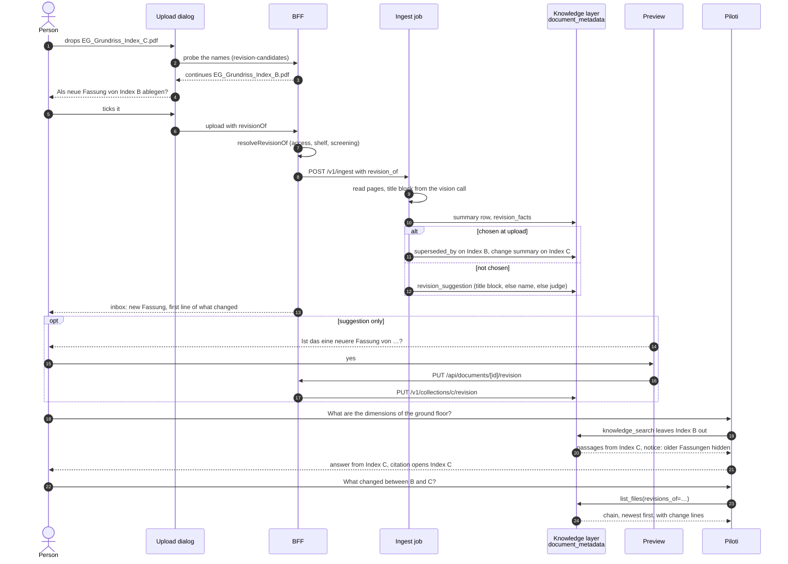

# Fassungen: how a document keeps its history

A document in Piloti is one entry with every Fassung inside it. This page follows
that from the upload to the answer, and says which module owns each step. What
the word means: [`CONTEXT.md`](../../CONTEXT.md), „Fassung“. What a person sees
and does: [`documents.md`](../user-guides/documents.md#fassungen-und-freigabe).
Why the link is not a merge:
[ADR-0099](../adr/0099-fassungen-across-file-names-are-a-confirmed-link-not-a-merge.md).
Why a same-name re-upload is a version:
[ADR-0054](../adr/0054-document-versions-and-the-publish-door.md).

A file name with an index says a file has Fassungen. It does not say what kind of
file it is; only the Dokumentart says that.

> **The model below is being replaced.** [ADR-0104](../adr/0104-a-document-is-a-timeline-of-fassungen-and-approval-is-separate.md)
> (accepted) makes every Fassung, under any name, a row of one document's
> timeline, keys the index by Fassung, and takes approval out of the history.
> This page describes what runs until each of its slices lands, and changes
> with it.

## The model

A Fassung is stored in one of two ways, and the reader sees one of them.

| | Same name | Another name |
|---|---|---|
| Gesture | Drop `EG_Grundriss.pdf` on a collection that holds `EG_Grundriss.pdf` | Drop `EG_Grundriss_Index_C.pdf` where `EG_Grundriss_Index_B.pdf` lies |
| Stored as | A new row in `document_versions` of the same `documents` row (ADR-0054) | Two `documents` rows, and a link on the knowledge layer's `document_metadata` row |
| The link | None. The item keeps its id | `superseded_by` on the OLDER row, set only by a person |
| What else is stored there | State per version, who approved, who published | `revision_suggestion`, `change_summary`, `change_basis`, `revision_facts` (the title block) |
| Who decides it is one | The name, so nobody has to | A person, after a suggestion |
| Undo | Not needed, the old bytes stay | Unlink. No citation, share, assignment or folder placement moves |
| Owner | `frontends/ui/src/lib/documents/lifecycle*.ts`, `version-repository.ts` | `src/aiq_agent/knowledge/document_metadata_store.py` |

`supersedes` is never stored. It is the reverse of `superseded_by`, derived when
the listing is read.

**The UI shows one entry and one timeline.**

- The file listing shows the current Fassung only. Quiet text, „3 Fassungen“,
  says how many the document has: beside the name in the list, after the
  approval state on a card, never in the „Freigabe“ column. The older documents
  leave the listing, and the filter „Auch zeigen: Ältere Fassungen“ brings them
  back, each with one badge, „Ältere Fassung“, whose tooltip names what replaced
  it; their approval state („Ersetzt“) is not shown beside it
  (`features/documents/lib/revision-chain.ts`, `revisionCount`,
  `withoutOlderRevisions`; `components/revision-badge.tsx`).
- The folder brief and the folder tiles count the same entries: `buildFolderBrief`
  leaves out every older Fassung whose newer one is in the corpus, whatever the
  filter says, so its headline, pages, chips, „Hier sind Sie gefragt“ and „Alle N
  erneut lesen“ never count or re-read a replaced Fassung.
- The preview's section „Fassungen und Freigabe“ lists every state, newest first:
  the same-name uploads and the older documents under other names, merged by date
  (`features/documents/lib/revision-timeline.ts`, rendered by
  `components/document-revisions.tsx`), numbered „Fassung 3, 2, 1“ across both.
  Each row has its index or date as a tag, who and when, what changed, Öffnen,
  and download and compare behind its ⋯. An earlier upload under the same name
  offers none of the three to a reader who may not receive its bytes
  (`bytesReadable` on the version listing, see Privacy). The header speaks about the newest
  Fassung and names the older one Piloti still answers from by number
  (`features/documents/lib/revision-standing.ts`). Which one that is follows the
  reading status as well as the review state: a published upload that is still
  being read, or failed, is not current, and the upload it replaced is
  (`answeringVersionId` in `revision-timeline.ts`), because a person's re-upload
  retires the old passages only after the new ones are stored.
- Nothing about the link model reaches the person.

## Detection

Piloti recognises a new Fassung in five places, cheapest first. Each one produces
a suggestion or a decision. None of them links two documents without a person.

| Layer | Reads | Says | Model call | Code |
|---|---|---|---|---|
| Name grammar | The file name: `Index C`, `idx-B`, `Rev 12`, `v3`, a date as `2026-08-14`, `14.08.2026`, `260814_…`, a bare letter after a sheet number (`A-101_C_…`) | Which names are one series, and which looks current | No | `frontends/ui/src/lib/documents/revision-series.ts`, `sources/knowledge_layer/src/revision_series.py` |
| Title block | The Plankopf: document number, Index, date, scale, title, read once per drawing page during ingestion | Same `document_number` means same document. Higher Index, else later date, means later state | No extra call: it rides the drawing analysis | `src/aiq_agent/knowledge/title_block.py`, `sources/knowledge_layer/src/llamaindex/visual_analysis.py` |
| LLM judge | Name, Dokumentart, tags and one-line summary of up to eight candidates in the collection | Whether the new file is a newer Fassung of exactly one of them | One, on the summary model | `src/aiq_agent/knowledge/document_revisions.py` |
| Derived on read | The rows already stored: title blocks first, then the name grammar | A suggestion for documents ingested before the Fassung step existed | No | `sources/knowledge_layer/src/llamaindex/revisions.py`, `derive_suggestions` |
| Upload decision | A tick in the upload dialog | „Als neue Fassung von X ablegen“ | No (only the change summary) | `revision_of`, below |

### Name grammar

The same grammar runs in TypeScript and Python. One fixture holds both to the same
reading, so the upload dialog and the agent's `list_files` cannot disagree about
which Fassung is current: `tests/fixtures/revision_series_cases.json`, run by
`frontends/ui/src/lib/documents/revision-series.spec.ts` and
`tests/knowledge_layer_tests/test_revision_series.py`. Change a rule on one side
and the fixture must move.

- A name with an index or a date has a **series key**: the name without index,
  date and extension. A series needs two different revisions; one Fassung
  uploaded twice is a duplicate.
- A PDF and a DWG of one Fassung are not versions of each other, so the format is
  part of the series.
- When every revision has an index of one kind, the index orders them, then the
  date. Otherwise the date leads. Upload time settles what is left, so the order
  is total.

### Title block

The vision call that already reads every drawing page also fills
`document.title_block` (drawing analysis schema v5). Nothing is taken from the
drawing body or the file name, and a field that is not printed stays empty.

- `revision_facts_from_documents` picks the record a document stores: the first
  page, in page order, whose title block names the document or its state. Pages
  are not merged. The record carries the `page` it came from.
- `adapter.py` writes it with `set_document_revision_facts` right after
  `register_summary`. A re-upload without a title block clears the old record.
- A title block beats the file name, because it is what the office printed on
  the sheet. `compare_revisions` answers „unknown“ rather than guess when one
  side has an Index and the other has none, or when a letter meets a number.

### Judge and its order

`record_revisions` runs once per file after the summary row is written, bounded
by `REVISION_TIMEOUT_SECONDS` (45 s) and fail-open: it cannot fail an ingest.

1. A `revision_of` choice from the upload dialog is written as a confirmed link
   (`confirm_revision`).
2. A name that was already in the collection is a same-name version. Only a
   change line is written (`record_change`).
3. A new name goes to `suggest_revision`. The title blocks settle it first
   (`settle_by_title_block`): the newest older state with the same number is
   stored with `basis: title_block` and confidence 0.95, and no model is called.
   If the blocks cannot say which is later, or there is no title block, the judge
   reads the candidates. It stores a suggestion only when the answer names one
   candidate exactly, with confidence of at least 0.7 and a reason.

A suggestion carries `of`, `confidence`, `reason` (German, at most 160
characters), `basis` (`title_block`, `name` or `content`), `dismissed` and
`dismissed_of`: every file a person refused as the older Fassung of this one.
A refused pair is not offered again, by the judge, by a suggestion derived on
read, or by a later write: `set_revision_suggestion` keeps the refusals and stores
a suggestion that names a refused file as dismissed. A record written before the
list existed (one `of` with `dismissed: true`) reads as one refusal
(`document_metadata_store.dismissed_revisions`).

### Suggestions derived on read

A document ingested before this existed has no stored suggestion. When the listing
is read, `derive_suggestions` computes one from the rows: the same
`document_number` with a later Index or date (`basis: title_block`), else the
index or date in the names (`basis: name`, confidence 0.9). It is stored nowhere,
and it is never made for a pair a person dismissed or linked, for a file that
already has an open suggestion, or for a name the job store lists as held or in
flight. When the job store cannot be read, nothing is suggested. When the sheets
say the name's newer file is not the later state, the sheets win and nothing is
suggested.

## How a person confirms

| Where | What happens | Code |
|---|---|---|
| **Upload dialog** | The dropped names are read with the grammar and probed against the shelf (`POST /api/documents/revision-candidates`), each with the folder it lands in (`PlannedFile.landsInFolderId`: the existing folder, or the nearest existing one above a folder the upload creates). Only documents of the collection that folder files into are offered, because a restricted folder is a collection of its own (ADR-0087) and a link lives in one. A name that continues a document offers „Als neue Fassung von X ablegen“. Forty such names become one decision with „Alle als neue Fassung ablegen“. | `lib/documents/revision-candidates.ts`, `features/documents/lib/revision-proposals.ts`, `components/folder-upload-dialog.tsx` |
| **Preview** | The section asks „Ist das eine neuere Fassung von …?“ with the reason and the basis. Yes links. No dismisses the suggestion. | `components/revision-notices.tsx`, `components/document-revisions.tsx` |
| **Older data** | The same question, on the file, from the suggestion derived on read. | `revisions.derive_suggestions` |

A row of the timeline can also **unlink** an older Fassung.

**At upload.** The form field `revisionOf` carries the older document's id.
`resolveRevisionOf` checks it before a byte is stored: write access to the older
document, same shelf and collection, active, past screening, a person's upload.
Equal names return nothing, since that is a version and never a Fassung. A
choice that fails a check (the older document moved into a restricted folder
after the dialog asked, was archived, is not this person's to change) never
refuses the upload: the file is stored as a document of its own, the answer
carries `revisionOfIgnored` with the reason, and the `document.uploaded` audit
event records it. A document the person may not see and one they may not
change are both `unavailable`, so the answer says nothing about which. The
dispatch then sends `revision_of: <older file name>` to `POST /v1/ingest`. Once
the new file has been read, `confirm_revision` writes what the PUT below writes,
through the same store step. The link is the person's and waits for nothing: it
is written when the summary model is off (then without a change line) and when no
summary could be made (the new file's row comes later, from the listing's
reconciliation backfill, and the link counts from then). An older file the
collection no longer holds, or a link that would close a loop, falls back to the
ordinary suggestion. A file the screening holds (ADR-0086) is
never read that far; the dispatch keeps the choice on the BFF row
(`documents.metadata.filingChoice`, `lib/documents/filing-choice.ts`) and the
reviewer's release sends it again, for the same bytes only. The choice is kept as
the older document's id, and the release checks it again
(`resolveReleasedRevisionOf`: active, past screening, same shelf and collection)
and sends the older file's name as it is then; a choice that no longer resolves
is dropped, since the release can come days later.

**After reading.** `PUT /api/documents/[id]/revision` takes `{ older, linked }`.
`setRevisionLink` loads both documents with write access and refuses a held
upload, a chat attachment, an archived document and two collections. It calls
`PUT /v1/collections/{c}/revision` with `{ newer, older, linked }` by file name
and the organization and user headers, so the change summary runs on the
organization's credential and data policy (BYOK, ZDR) and its spend is booked
to it,
audits `document.revision_changed`, and answers with the facts of both documents
as this reader now sees them.

On the Python side, `linked=true` goes through `link_revision`
(`document_metadata_store.py`): in one transaction, under an advisory lock per
collection on Postgres and a process lock on SQLite, it reads the links, refuses a
loop (409), sets `superseded_by` on the older row, clears a suggestion on the newer
row that named the older one (its refusals stay), and, when the older row was
replaced by another file X until now, drops X's change line told against it. Two
people confirming A over B and B over A at once therefore store one link, not a
loop. Then the summary model writes what changed onto the newer row with the older
name as `change_basis`; a model failure leaves the link and an empty change line.
`linked=false` lifts the link, removes the change line written against it, and adds
the older name to the newer row's refusals (`dismiss_revision_suggestion`).

## When a document leaves and comes back

The link is a fact on the knowledge layer's row, and several BFF operations take
that row away with the chunks (`DELETE /v1/collections/{c}/documents`, which ends
in `DocumentMetadataStore.unregister`). Most of them are undone later by reading
the document again. A link only a person makes has to survive that.

| BFF operation | Undone by | Sends |
|---|---|---|
| Archive (`archiveDocument`, `lib/documents/version-content.ts`) | An un-archive, which re-reads the index (the row and every version stay; the BFF has no un-archive yet) | nothing (`permanent: false`) |
| Folder to the bin (`purgeChunksOf`, `lib/projects/folder-bin.ts`) | Restore from the bin (`restore_folder_bin` job) | nothing |
| Publish purges the replaced version (`purgeSupersededChunks`, `lib/documents/lifecycle.ts`) | The publish re-reads under the same name | nothing |
| Delete, Archiv delete, the bin's final purge (`eraseProjectDocument`, `lib/office-shelf/service.ts`) | Nothing | `permanent: true` |
| Move to another collection (`moveDocument`, `lib/projects/collection-placement.ts`) | Nothing in the old collection: Fassungen share one collection, so its links end there | `permanent: true` |

The flag is one option of the one purge call, `purgeIngestedChunks(…, { permanent: true })`
(`lib/documents/collection-file-ref.ts`); every caller that omits it asks for the
reversible purge, and the specs of each caller above pin which one it sends.

**Without `permanent`** the row goes, and what a person made on it is kept under
`(collection, file name)` in `document_revision_retained`: the row's own
`superseded_by`, its refusals (`dismissed_of`), and a change line whose
`change_basis` is another file (one told against the document's own earlier
upload describes bytes the re-read replaces, and an open suggestion is Piloti's,
read again). The links other rows hold TO it are left alone. While it is gone they
read as nothing, because `_attach_supersedes` and `get_superseded_files` count a
link only while both rows exist: the older Fassung it replaced answers again. The
next `register` of the name takes the kept facts back in the same transaction, and
a column the row already fills wins. A kept link that would now close a loop (the
other direction was linked while the file was gone) is not taken back.

**With `permanent`** nothing is kept, and every link to the file, on a live row or
a kept one, is cleared: a later upload under the same name is another document.

„Erneut lesen" does not purge. A re-read of the same name keeps the row, so the
link was never at risk there (`register` writes only the summary, tags and topics).

## Freigabe on the same file

Freigabe is about the same-name chain. It says whether anybody stands behind the
content of a version. It is not the link between two documents.

| State | Meaning |
|---|---|
| `draft`, `in_review`, `changes_requested` | Being worked on. At most one open version per document. |
| `approved` | Only a version approved before approval became one step (ADR-0104): asserted, not yet answering, published by „Veröffentlichen“. Nothing lands here any more. |
| `published` | The version the index holds. |
| `superseded` | Replaced by a later published version. Bytes stay. |
| `rejected` | Closed without publishing. |

- **Only a published version is indexed.** The database holds the chain: a version
  that began as a draft (`origin = 'draft'`) may be published only if a person
  approved it, and only the `upload`, `approve` and `publish` transitions promote
  a version. `ingestPublished` appears on the `approve` and `publish` rows of the
  transition table and nowhere else (`lib/documents/lifecycle-types.ts`).
- **„Freigeben“ is one step** (ADR-0104 rule 5). Approving a version in review
  publishes it: it becomes the one Piloti answers from, and the open review round
  is decided in the same transaction. `publish` remains only for a version
  approved before this.
- **A person's upload is born published, and approved by nobody**
  (`origin = 'upload'`, migration 0137). Putting the file there is the assertion;
  no approver column carries the uploader's name. Approval matters for what
  Piloti wrote and for revisions that need a second pair of eyes.
- **Piloti answers from the published version** while a newer one is in review,
  and from the previous upload while a person's re-upload is still being read
  or after its reading failed. The section says so („Piloti antwortet weiter aus
  Fassung 1.“).
- **Publishing purges first.** The previous version's chunks go before the new
  bytes are sent, so a failed dispatch stops the document answering instead of
  answering from the version somebody replaced. ADR-0104 rule 2 (every read
  Fassung stays indexed, keyed by its id) is accepted and not built: until it
  is, search sees only the current Fassung of a name. Fassungen under
  different file names are both indexed.
- **Actors.** Approve, request changes, reject and publish are a person's. Piloti
  may create, update and submit.

The two notions meet in the timeline, and nowhere else: a Fassung under another
name shows as „Ersetzt“, while a same-name version shows its approval state.

## Compare

Four things, in rising cost.

| | What | Model | Code |
|---|---|---|---|
| **Look** | Two Fassungen side by side, overlaid (older cyan, newer orange) or swiped, page by page, through the preview's pdf.js runtime | No | `features/documents/components/revision-compare/` |
| **Pages and values** | For the agent: which pages changed, the values that moved in the printed text, the quantities and dimension strings that changed in the drawing reading, and the Plankopf. Read from the index, so nothing is read again | No | `src/aiq_agent/knowledge/revision_diff.py`, `list_files(compare_to=…)` |
| **Marks** | On request, or unasked where the office switched it on (below, „Piloti notices a new Fassung“), Piloti boxes what changed on the newer page and says it in words | One vision call per page pair, cached | `lib/documents/revision-compare-service.ts`, `routes/revision_compare.py`, `src/aiq_agent/knowledge/revision_compare.py` |
| **Words** | The change summary: what differs between two descriptions | Summary model, at ingest or at confirmation | `document_revisions.py`, `summarize_change` |

`POST /api/documents/[id]/revision-compare` takes `{ older, page }`.
`compareRevisionVisually` requires read access to both, neither held, both active,
one collection, and refuses a restricted folder (422, `restricted_folder`). It
forwards to `POST /v1/collections/{c}/revision-compare`, which

1. renders the same page of both stored originals,
2. sends both pages, older first, in one call on the organization's vision
   credential and its `ingest_vlm` model,
3. keeps at most 12 boxes in page-relative `0..1` coordinates. A box outside the
   page or without a label is dropped, never repaired,
4. caches the result by the content hashes of the two rendered pages, the model,
   the collection, the page and `PROMPT_VERSION`. A second click costs no model
   call. A failed call is never cached.

„Keine sichtbare Änderung“ is an answer. When no box and no sentence survive, the
person is told that, rather than shown an empty panel that could mean a failure.
Errors are 404 (page missing), 409 (not ingested), 503 (no vision model) and 502
(model failed). The text comparison of two same-name versions is a line diff
(`client.diff` in `document-revisions.tsx`).

## The agent

The agent reads the same facts the UI does, through the knowledge layer.

| Tool | What it does with Fassungen | Code |
|---|---|---|
| `list_files` | Marks a row that a person replaced („ersetzt durch X (bestätigt)“), then rows that share a title-block number („aktuelle / ältere Fassung laut Plankopf“), then the name reading. A confirmed link beats the sheets, which beat the name. Prints `Plankopf: Nr. …, Index …, Stand …` | `sources/knowledge_layer/src/browse.py`, `confirmed_revision_marks`, `title_block_marks` |
| `list_files(revisions_of=…)` | The whole chain of one document, newest first, with Index and date, upload date and what changed against the one before. The chain follows a confirmed link in both directions, the same title-block number and the name series, transitively | `browse.py`, `render_fassungen`, `_chain_members`, `_chain_order` |
| `list_files(revisions_of=…, compare_to=…)` | What changed between two Fassungen of the chain: the Plankopf, pages aligned by their text, values that moved in printed lines, and quantities and dimension strings from the drawing analysis. No model call; the stored change line rides along when its basis is exactly that older file | `browse.py`, `resolve_compare`, `compare_revisions`; `src/aiq_agent/knowledge/revision_diff.py` |
| `knowledge_search` | Leaves confirmed older Fassungen out of the ranking on the user shelves, so an older state cannot outrank its replacement on similarity. Says „Ältere Fassungen ausgeblendet: …“. `file_name=…` bypasses the exclusion, and when the named file is an older Fassung the result carries the same line `read_passage` gives („Ältere Fassung: … ist durch … ersetzt“, the end of the chain). The base corpus is untouched | `sources/knowledge_layer/src/register.py`, `_superseded_files`, `_named_older_revision_notice`; `document_metadata_store.get_superseded_files` |
| `read_passage` | Reading an older Fassung is allowed, because „Index B“ and „die alte Fassung“ ask for it. A one-line notice names the current one and tells the answer to say it read the older state | `sources/knowledge_layer/src/read_passage.py`, `_current_revision`, `_older_revision_notice` |
| Inventory | A row suffix carries only the confirmed link, never a suggestion | `src/aiq_agent/knowledge/inventory.py` |

A citation of an older Fassung says so. The citation peek shows „Ältere Fassung –
aktuell: …“ with a button that opens the current one
(`features/chat/components/CitationPeek.tsx`, `OlderRevisionLine`;
`features/chat/hooks/use-open-current-revision.ts`). The link is visible to the
peek only if the reader may open the newer document.

A stored suggestion is advice to a person and is not shown to the agent's model.
What the agent sees is the confirmed link and two readings, the sheets and the
name, each labelled as what it is.

## Notifications

`document.new_revision` is one inbox item per recipient (`lib/documents/revision-notify.ts`).

- **When.** A person confirms a link; a same-name version is published; or an
  upload settles after screening. A link written at ingestion exists before the
  job ends, so `announceSettledVersions` (called from
  `lib/upload-batches/settle.ts`) tells people the moment the document is
  readable.
- **Who.** The people assigned to the older document and its uploaders, and
  everyone working on an open Anmerkung the new Fassung leaves behind (its
  `markParticipants`: who set it, its Zuständige, who delegated it, answered or
  was mentioned in it; for a same-name version the open marks set on another
  version, for a link every open mark of the older document), minus the person
  who made the change, then cut to those who may open both documents. The row
  then says how many open marks to check and from which Fassung („4 offene
  Anmerkungen aus Fassung 2 prüfen“; „aus der vorigen Fassung“ when they sit on
  several, or on another document): `openMarks`, `marksRevision` and the
  `variant` that picks the words (`openMarksFacts`). Each is carried on in the
  Prüfansicht ([`document-annotations.md`](document-annotations.md#a-mark-goes-on-with-a-new-fassung)).
- **Who, for a quiet upload.** The upload batch that brought the newer
  document can narrow that to the mark participants alone
  (`upload_batches.revision_notice = 'marks_only'`, migration 0185):
  `announceSettledVersions` looks up the batch each settled document carries
  (`findMarksOnlyBatchIds`) and passes `audience: 'marks_only'`, which drops the
  assignees and uploaders before the access cut. The next Fassung of an
  E-Mail-Verlauf is news to nobody else, but a mark it leaves behind must not be
  orphaned silently. With no open mark nobody is told, and the Fassung is still
  claimed, so a later re-read does not announce it to everyone. A batch opened
  by the browser or an agent is always `all`: only a server-side caller sets
  the column. The `upload` transition's own announcement (`lifecycle.ts`)
  carries no audience; for a person's upload it says nothing, because the new
  bytes are held until screened, and the settle hook is the one that tells.
  Piloti's notice of a cross-name Fassung is not people being told and does
  not read the column. The document check (ADR-0130) reads its own,
  `runs_document_check`: off, no document of the batch is checked, so a
  conversation's next Fassung buys no model call, while a mail's attachments
  keep the check a filed drawing is worth.

  | Upload batch | `upload.completed` | Filing reviews | Intake reading | `document.new_revision` | Document check |
  |---|---|---|---|---|---|
  | A person's upload (default) | yes | yes | yes | `all` | yes, where the office has it on |
  | `announces_completion` off | no | | | | |
  | `reviews_filing` off | | no | | | |
  | `starts_intake` off | | | no | | |
  | `revision_notice = 'marks_only'` | | | | mark participants only | |
  | `runs_document_check` off | | | | | no |
- **What.** The first line of the change summary, at most 200 characters, and
  only when the summary was written against the older document of THIS
  notification (its basis). A summary against the earlier upload under the
  newer document's own name, or against a third document, describes another
  comparison, possibly with a document the recipient may not open, and is left
  out (`changeSummaryAgainst`, `changeAgainstName`). The
  names are the documents' display names without the file extension
  (`revisionRowNames`), unless the two would then read the same. Who made the
  change is the row's `actorUserId`, resolved to a name when the inbox is read,
  so the row reads „Sabine Gruber hat eine neue Fassung von „Grundriss EG
  Index B“ hochgeladen“ with the excerpt as its only body.
- **Next move.** For a link across two names the row's first action is
  „Fassungen vergleichen“: `…?doc=<newer>&compare=<older>`
  (`features/documents/lib/revision-compare-link.ts`), which the files workspace
  reads (`hooks/use-compare-param.ts`) to open the preview with the visual
  comparison on top. „Mit Piloti besprechen“ follows it.
- **Once.** Each Fassung is announced once: `notifyNewRevision` claims the newer
  document and the item's anchor (the new version, or the older document for a
  link) in `document_revision_announcements` (migration 0130) before it writes,
  and writes only when the claim took. The settle hook runs on every re-read
  („Erneut lesen“, the folder brief's bulk re-read, a retry), and without the
  record a person assigned since, or whose item had aged out, was told again.
  The claim is taken only once both documents are screened, so a held upload is
  announced when it passes, and a failed announcement gives it back. A
  recipient who still holds the item is skipped too, not folded, so a read item
  is never marked unread.
- **Never fails the caller.** `announceNewRevision` is detached and logs.

## Piloti notices a new Fassung

Where the office switched it on (WorkOS flag `piloti-notices`, off by default),
a Fassung under another name is compared without anyone asking, and what moved
is proposed as marks on it ([ADR-0130](../adr/0130-piloti-notices-a-new-fassung.md),
`frontends/ui/src/lib/revision-notice/`).

1. **Queued.** `notifyNewRevision` queues a `revision_notice` job right after it
   claims the announcement of a cross-name Fassung, so once per Fassung; the
   job id is uuid5 of the pair, and it waits `GRID_REVISION_NOTICE_DELAY_SECONDS`
   (120 s). A same-name version is not noticed: its older bytes left the index
   when it was published.
2. **As the person who made it.** The job runs as the announcement's actor (the
   uploader, or the person who confirmed the link), resolved from WorkOS when it
   runs, and asks the switch again from their session, then their budget
   (fail-closed). Every check of a click on „Vergleichen“ holds: both readable,
   neither held, one collection, no restricted folder.
3. **Which pages.** `POST /v1/collections/{c}/revision-pages` reads the changed
   pages of the newer Fassung from the index (`revision_diff.changed_pages`), no
   model call. Nothing changed: silence. A scan with nothing read: the first
   pages. At most `GRID_REVISION_NOTICE_MAX_PAGES` (3).
4. **What changed.** `compareRevisionPage` with `purpose: notice`, the compare a
   click runs, queued as `bulk` and traced with `purpose` in its metadata; the
   route returns the generation's `trace_id`.
5. **What it leaves.** Each box becomes a proposed `hint` on the new Fassung
   through `runAgentAnnotationRequest` (`op: propose`), its body what moved
   against which Fassung, its basis „Bildvergleich … nicht geprüft“. One message
   in the person's thread about the document names the pages compared, the
   proposals and the pages not looked at, and carries the trace id; the marks'
   change rows point at it, so a decision on a mark is a `piloti-decision` on
   that trace. One inbox row, `piloti.revision_checked`, opens the Prüfansicht at
   the first mark. Nothing found writes nothing but the score.
6. **Measured.** `revision-notice` (how many marks) on the trace of the first
   compared page.

It never links, unlinks, sets a mark open or says whether a change is allowed.
Checking what a new document states against the project's other documents is
the second notice, the `document_check` job: a headless turn that proposes cited
marks only where facts disagree, queued for a first upload too
(ADR-0130, „Second slice“).

## Privacy

| Rule | Where it holds |
|---|---|
| A held or unscreened document's name or content never reaches a model, or a reader who may not see it (ADR-0086, ADR-0087) | `held_file_names` removes held and in-flight names from the judge's candidates, and when the job store cannot be read nothing is suggested. `derive_suggestions` does the same. The BFF refuses a held document in the link, compare and `revisionOf` paths with a 404. `revision-notify.ts` re-reads both documents with the screened-only reader before it writes a row |
| An earlier upload's bytes reach a person only if a passing verdict judged them | `mayReceiveVersionBytes` (`version-content.ts`) on `…/versions/{id}/file` and `/content` (and so the diff): bytes a passing verdict judged (`versionBytesPassedScreening`), or the uploader and the quarantine's reviewers (`maySeeHeld`). Everyone else gets a 404, and the version listing's `bytesReadable` keeps the timeline from offering it. Each version records its own verdict, below |
| A name the reader may not open never reaches the browser | `resolveRevisionLinks` drops a reference it cannot resolve, and a change summary that describes it. `loadRevisionLinks` resolves names only to documents of the same collection, active, visible to this reader and outside a closed folder |
| The history walk drops what the reader cannot see | `walkHistory` follows `supersedes` breadth first (cycle-safe, at most 40), then each entry is looked up with the reader's visibility. A hidden direct predecessor leaves the document's own facts empty while older Fassungen behind it may still show |
| A restricted folder is never compared by a model | 422 `restricted_folder` in `compareRevisionVisually` |
| GPS never goes to a model | A photo's latitude and longitude are stored for the BFF and are never printed into a prompt (`factory.py`, `set_document_capture`). The judge and the change summary read name, Dokumentart, tags, summary and title block, none of the capture facts |
| Traces carry no pixels | `revision_compare.traceable` replaces each page image by its size before it reaches Langfuse |

### Each version carries its own screening verdict

A verdict lives on the item (`documents.screened_hash`, ADR-0086), and a
re-upload resets it, because the new bytes are unscreened. So the verdict about
an earlier upload's bytes is kept on its version: `document_versions.screened_hash`
(migration 0131) is the `content_hash` of those bytes when a verdict passed them.

- **Written with the item's verdict, by one writer.** `recordVersionVerdict`
  (`lib/documents/repository.ts`) runs in the transaction that records the
  item's verdict. When the reconcile settles a job as `completed` with a passing
  outcome, every version of the document holding the bytes that job judged
  (the hash the dispatch recorded) is marked. A quarantine of those bytes clears
  the mark, so the latest verdict about the bytes is the one on record. A
  reviewer's release marks the released bytes. A forked draft carries its
  source's value with the bytes it copies.
- **Read by one rule.** `versionBytesPassedScreening` (`document-reader.ts`):
  the item must have passed, and a version holding a person's upload
  (`published`, `superseded`) must hold bytes a passing verdict judged, its own
  (`screened_hash = content_hash`) or the item's. Workflow text follows the
  item, Piloti's own documents are never held.
- **So** a member opens, downloads and compares every screened earlier upload,
  and an upload replaced while it was still being read, after its reading
  failed or while quarantined stays closed to everyone but its uploader and the
  reviewers.
- **Backfill (0131).** A version was marked where the rows prove a pass about
  exactly its bytes: the item's passing verdict about them, or a reviewer's
  release of them (`screening_released_hash`) that no current quarantine of the
  same bytes overrides. A version superseded before 0131 whose item verdict a
  re-upload had already reset carries no proof and stays closed to members, as
  it was before. `scripts/rls-test-db.sh` checks the rule row by row.

## Observability

| Model call | Where it runs | Langfuse |
|---|---|---|
| Title block | Inside the drawing analysis, the vision call that reads the page | No generation of its own. Ingest spend is on the usage ledger as `activity=ingest` |
| Judge and ingest-time change summary | On the summary model at ingest (`record_revisions`) | Same as above |
| Change summary at confirmation | `PUT /v1/collections/{c}/revision` | Generation `change-summary` |
| Visual compare | `POST /v1/collections/{c}/revision-compare` | Generation `revision-visual-compare`, pixels left out |

`frontends/aiq_api/tests/test_model_calls_are_traced.py` keeps both route calls
observable. The catalogue of trace names is in
[`langfuse.md`](../observability/langfuse.md).

## From upload to answer

## Known gaps

- **An earlier upload superseded before migration 0131 may stay closed to
  members.** Where the item's verdict about it had already been reset by a
  re-upload, nothing on record proves its bytes passed, so the backfill left it
  unmarked and only its uploader and the reviewers open it. Nothing re-screens
  such a version today; a reviewer's release is per document, not per version.

- **A re-read after a failed first ingest loses `revision_of`.** `reingestDocument`
  dispatches without it (`frontends/ui/src/lib/documents/service.ts`), so the
  confirmed link is never written. The file falls back to the ordinary path: a
  title-block, name or content suggestion, which a person must confirm again. If
  none of the three fires, nothing is offered.
- **Visual compare of two same-name uploads is not supported yet.** The compare
  view loads pages by document id. Two versions of one document get the text
  comparison only (the TODO in `components/document-revisions.tsx`). Linked
  documents under different names compare visually.
- **Compare is page for page.** Page `n` of the older Fassung meets page `n` of
  the newer one. A sheet added in the middle shifts every pair after it.
- **Live vision quality is unmeasured.** Title-block reading and the change boxes
  are tested against fixtures and mocks. No set of real drawings has been scored
  for the Index and number the model reads, or for how many boxes land on the
  right spot. Treat both as suggestions, as the UI does.
- **The change summary compares descriptions, not drawings.** It can miss a
  changed dimension, and the UI says so. The visual marks are the check on the
  page itself.
- **One title block per document.** The first page that names the document or its
  state is stored. A set of sheets under one file name has one number and one
  Index.
- **The link lives on the knowledge layer, not in the BFF database.** A document
  purged on one side leaves a dangling name, on purpose while the purge can be
  undone (above). The BFF drops a reference it cannot resolve, and the search
  query checks that the newer row still exists.
- **Only the Fassung facts are kept across a purge.** The row's person-set tags,
  topics, Dokumentart and display title go with it; `POST /v1/ingest` carries
  only `folder_path` (and `revision_of`) back when the document is read again.
- **Restricted folders cannot be compared** by a model.

## Where to change what

[`where-is-what.md`](where-is-what.md) lists the owning module for each piece
above. The ingestion contract is in
[`document-ingestion.md`](../technical-reference/document-ingestion.md),
the routes in [`python-endpoints.md`](../api/python-endpoints.md) and
[`bff-routes.md`](../api/bff-routes.md).
